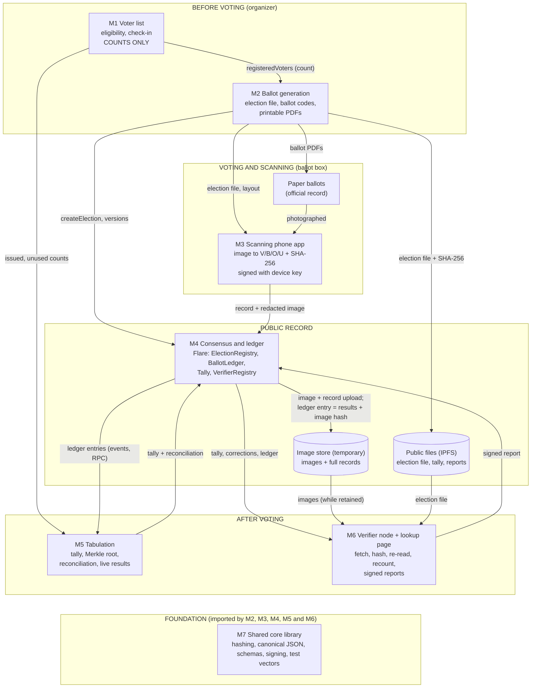

# B.E.I.N.G.S. Architecture and Data Flow

*For coders: the seven modules, what each one hands to the next, and the order to build them*

> **DRAFT FOR DISCUSSION — v0.2, 31 October 2026 (wallets and keys added).** Companion to the Technical Design Specification v0.8 (the spec). Where this document and the spec differ, the spec wins; please report the difference. Items marked **[PROPOSED]** are not yet in the spec and need a decision. Not legal advice, not an audited design.

## 1. Purpose and scope

The spec says **what** B.E.I.N.G.S. must do. This document says **how to split the work** into seven modules with clear hand-offs, so several people can build in parallel against fixed formats.

- **The model:** paper ballots stay the official record. **Each ballot is scanned once**; the ledger (Flare) permanently holds that ballot's **results and image hash**; the scanned **images sit in a separate image store for a limited time**; **many independent verifier nodes** check it all (spec Sections 5 and 9).
- **Out of scope:** election operations such as check-in desk procedure, ballot custody, accessibility and certification follow the host's protocols (spec 2.1). M1 only supplies **counts**.
- **Wallets and keys:** anything that **writes** to the chain needs a wallet; **reading needs none**. Section 13 gives the roles, wallet options and the relayer path.
- **Language:** *record* means the full ballot record file; *ledger entry* means the permanent on-chain results and image hash (spec 11.2).

| Module | Name | One-line job |
|---|---|---|
| **M1** | Voter list | Eligibility and check-in **counts only**. Never linked to ballot codes. |
| **M2** | Ballot generation | Election file, unique ballot codes, printable ballot PDFs. |
| **M3** | Scanning | Phone app: image to V/B/O/U data and image SHA-256, signed by the device key. |
| **M4** | Consensus and ledger | Flare contracts; upload to the image store; post records. |
| **M5** | Tabulation and live results | Tally, Merkle root, count reconciliation; live results only when regulations permit. |
| **M6** | Verifier node | Independent fetch, hash check, re-read, recount; signed reports. Plus the public lookup page. |
| **M7** | Shared core library | Hashing, canonical JSON, schemas, signing. Used by M2 to M6. |

### Conventions every module follows (spec 9.7 and 11)

- **Hashes:** SHA-256 for files and images (hex, lower case); keccak256 for EVM structures and Merkle trees.
- **Canonical JSON:** RFC 8785 (JCS) before hashing or signing any JSON.
- **Signatures:** EIP-712 typed data, secp256k1. Each phone, the organizer, reviewers and verifier nodes have their own key; private keys never leave the holder.
- **Identifiers:** election code `BEINGS-YYYY-XXXXXX`; ballot code 12 characters of Crockford base-32; ballot key `keccak256(ballotCode)`; choice IDs `c1`, `c2`; question IDs `q1`, `q2`.
- **Results:** per question `V:<choiceId>` (multi-mark `V:c1+c3`), `B`, `O` or `U`; fill scores 0 to 100.
- **No PII, ever,** in any file, contract, log or image store (spec 3.2).

\pagebreak

## 2. System diagram

*Figure 1. Modules and data hand-offs. Arrows carry data. M7 is a library compiled into the other modules, so it has no data arrows. Only counts leave M1. The ledger and M6 are the only parts everyone can read.*

\pagebreak

## 3. M1 Voter list

| Aspect | Detail |
|---|---|
| **Purpose** | Hold the register of eligible voters, support check-in, and produce **aggregate counts** for reconciliation. It exists so the count is checkable; it is **never** connected to ballot codes or ballots. |
| **Inputs** | The host's register (CSV or spreadsheet, or the host's own system). Check-in events at the desk (voter marked as issued a ballot; spoiled-ballot replacement; ballot returned unmarked). |
| **Outputs** | `registeredVoters` (integer) for the election file (M2). **[PROPOSED]** a small `checkin-counts` JSON for M5: `{ electionCode, issued, unusedReturned, at }`, counts only, signed by the organizer key. Schema: new, see Section 12. |
| **Interfaces** | CLI or small local web form: `import-register`, `check-in`, `replace-spoiled`, `export-counts`. No network API. Nothing here is called by M3, M4 or M6. |
| **Data stores** | Local file or SQLite on the organizer's computer. **Offline and never published.** The check-in list is not linked to ballot codes in any table, file or log. |
| **Trust boundary** | Fully inside the organizer's custody. Only the exported counts cross the boundary (to M2 and M5), and they are checked by the public reconciliation (spec Section 8). |
| **Privacy rules** | No voter names, lot numbers, IDs or timestamps leave M1. Check-in order is not recorded alongside any ballot data. Counts are exported once, at set times, never per voter. The desk must not write ballot codes next to names. |
| **Failure handling** | Counts that do not match later (R1 to R4, spec 8.3) are not "fixed" in M1: the mismatch goes to review. Corrections to counts are new dated exports; old exports are kept. A lost check-in list means the count is stated as unverified in the review note. |
| **Suggested stack** | Hosts' existing system where one exists (this module is deferred to host protocols, spec 2.1). Otherwise a minimal TypeScript or Python CLI over SQLite; CSV import and export. Reuse M7 for the signed counts file. |
| **Classroom pilot** | The teacher's class list on paper or a spreadsheet. The only machine input is one number: **class size as `registeredVoters`**. Issued and unused counts are typed in at the close. No software needed beyond M2's field for the count. |

\pagebreak

## 4. M2 Ballot generation

| Aspect | Detail |
|---|---|
| **Purpose** | Turn an election definition into a **public election file** and **printable ballots**: unique random ballot codes, QR codes, ovals, corner markers and a tear-off receipt (spec Sections 6 and 11.1). |
| **Inputs** | Election definition (name, questions, choices, `maxMarks`, rules, privacy, dates); `registeredVoters` from M1; the number of ballots to print incl. spares; approved scanner-app hashes (from M3 build); optional `imageStore` and `imageRetention` settings. |
| **Outputs** | **Election file** JSON (schema: Election file, spec 11.1) with `ballotCodes`; its SHA-256 and CID. **Printable ballot PDFs** (one per ballot or one batch PDF, each with its code in text and QR, receipt stub). **[PROPOSED]** a **ballot layout file** (`ballot-layout` JSON): oval centers and sizes relative to the corner markers per question and choice, page size, marker positions; its SHA-256 is the `layoutHash` field of the election file (optional in the schema so older files stay valid, always written by M2), so the election file hash recorded on-chain also covers the layout. The printed ballot shows each question ID (`Q1`) and choice ID (`c2`), matching the IDs in the ledger result strings. M3 and M6 need it to find the ovals. |
| **Interfaces** | CLI: `beings gen --definition election.yaml --count N --out dir/`; library call `generateElection(def) -> {electionFile, layout, ballots[]}`. Writes files only; hands the CID and SHA-256 to M4 (`createElection`, `postVersion`) through M4's client. |
| **Data stores** | Output directory (files). Ballot codes come from a CSPRNG and are **not derivable** from names, order or each other. Printed batch records stay with the organizer (custody is a host protocol). |
| **Trust boundary** | Organizer-controlled and **signed**: the organizer key signs the file hash that M4 records on-chain. Anyone can check the election file against the registry and re-derive the layout from it. Nothing generated here is secret except unprinted PDFs before the event. |
| **Privacy rules** | Ballots carry **no marks other than the random ballot code** (spec 3.2): no names, icons, or sequential serials. Codes are shuffled before printing so print order tells nothing. The election file contains no identities. |
| **Failure handling** | Duplicate or malformed code: regenerate the batch (checked against the schema and pattern before output). Reprint: new codes only if the election file is superseded (new `version`, `supersedes` CID); spoiled ballots are logged, never reused. Printing a bad batch: discard and regenerate before voting opens. |
| **Suggested stack** | TypeScript on M7 (`pdf-lib` for PDFs, `qrcode` for QR, `ajv` for schema checks), or Python (`reportlab`, `qrcode`) against M7's test vectors. Corner markers sized for robust OpenCV detection. |
| **Classroom pilot** | One run for one class: a few questions, plain-paper printing on the school printer, `registeredVoters` = class size, `imageRetention` = short (for example 14 days, delete). No spares beyond a few for spoiled ballots. |

\pagebreak

## 5. M3 Scanning

| Aspect | Detail |
|---|---|
| **Purpose** | Photograph one ballot, find the QR code and corner markers, measure each oval, decide **V/B/O/U** for every question, hash the image, and **sign the reading** with this phone's own device key. **One scan per ballot** is the default (spec 5.6). |
| **Inputs** | Camera frames of the ballot. The election file (questions, `ballotCodes`, `resultRules`, `approvedAppHashes`), the layout file, and the phone's device key. |
| **Outputs** | A **ballot record** JSON (spec 11.2 full record): `ballotCode`, `results`, `readings[]` (device, `imageSha256`, optional `imageRef`, `fillScores`, signature), `review`, coarse `scannedOn`. Plus the **redacted image** file (only bubbles, ballot code and QR remain; the raw image stays sealed, with only its hash recorded). |
| **Interfaces** | In: camera (browser or OS API). Out: a local queue of `{record.json, image.png}` pairs, handed to M4's posting client (same device or a box coordinator device). Internal API: `scanBallot(frame, electionFile, layout) -> {record, image}`; `reviewDecision(record, reviewerKey)` for Unclear (U) questions. |
| **Data stores** | On-device queue (IndexedDB or app storage) until posted. The **device private key** is generated on the phone and never exported. Raw images kept sealed or discarded under the host's protocol. |
| **Trust boundary** | The phone and app are **not trusted by the public**: its reading is checked by the ledger rules (valid device signature, known app hash) and then by M6 verifier nodes. The phone must trust only its own key and the election file it fetched by hash. |
| **Privacy rules** | Crop and blur everything except the bubble areas, ballot code and QR **before the image leaves the phone**. Round or drop scan times (`timeGranularity`). Do not log scan order. No location or device metadata in the record. The queue is posted in sorted or shuffled order, never scan order. |
| **Failure handling** | Unreadable QR or markers: retake, else mark the ballot for hand count and note it in the review log. Any **U** answer goes to human review (reviewer signs the final result). Unknown or already-used ballot code: reject and alert the coordinator. If offline, keep the queue and sync later (`submitBatch`, spec 10.2). App hash not approved: M4 rejects the device. |
| **Suggested stack** | Wallet access through the wallet adapter (Section 13). **Web PWA** in TypeScript with `opencv.js` for OMR, `getUserMedia` for the camera, `@noble/secp256k1` and M7 for signing. Note: browsers cannot use hardware-backed secp256k1 keys; if secure-hardware key storage is needed, use **React Native** with the platform keystore. Keep the OMR code small and well-tested so independent builds (M6) can match it. |
| **Classroom pilot** | **Exactly one online phone** in a cardboard box; it holds its own key and wallet; no multi-device agreement, no offline sync. The teacher is the reviewer for **U** ballots. A lamp and a fixed phone stand reduce glare. |

\pagebreak

## 6. M4 Consensus and ledger

| Aspect | Detail |
|---|---|
| **Purpose** | Make the record **public and tamper-evident**. Registers the election, accepts one ledger entry per ballot (results plus image hash), stores the images temporarily, and records tallies, corrections and verifier reports. Flare validators secure the ledger; they do **not** check images (spec 5.7). |
| **Inputs** | From M2: election file CID and SHA-256, counts, dates, ballot-list Merkle root. From M3: record JSON + redacted image + signed reading(s). From M5: tally and reconciliation. From the organizer or reviewers: corrections, `markSpoiled`, `noticeImagesRetired`. From M6: verifier reports. |
| **Outputs** | On-chain: **ledger entry** per ballot (`results`, `imageSha256`, `recordSha256`, `reviewed`), correction chain, tally, reconciliation, verifier report notices, events. Off-chain: the record and image in the **image store** (retention period only). |
| **Interfaces** | **Contracts** (spec Section 10): `ElectionRegistry` (`createElection`, `postVersion`, `registerDevice`, `registerReviewer`, `openElection`, `closeElection`, `noticeImagesRetired`), `BallotLedger` (`submitRecord`, `submitBatch`, `postCorrection`, `markSpoiled`), `Tally` (`postTally`, `clearReview`, `postAmendedTally`, `isFinal`, `verifyInclusion`), `VerifierRegistry` (`register`, `reportVerification`; no write path into the other contracts). **Client library** `ledger-client`: wraps these calls with M7 types, plus the **wallet adapter** and optional **relayer** (Section 13). **Image store adapter:** `put`, `get`, `exists`, `delete` (Section 12, contract IC10). |
| **Data stores** | **Flare** (permanent). **Public files on IPFS** (election file, tally, reports; pinned with at least two providers). **Image store** (temporary): IPFS with a pin service the organizer controls, or an ordinary image database or object store, named in `imageStore`. Linked **by SHA-256 only**. |
| **Trust boundary** | The chain enforces: device keys and app hashes registered before opening, the election is Open, one entry per ballot, valid signatures, quorum (default 1). It cannot judge whether a ballot was read correctly: that is M6 plus human review. The image store is **untrusted for integrity** (any copy is checked against the on-chain hash) and trusted only for availability. |
| **Privacy rules** | Only results, hashes and counts go on-chain. Images and full records stay off-chain and expire per `imageRetention`. Retention extends while a review or recount is open; after it, delete or officials hold, and post a notice. Copies others made cannot be recalled, so redaction in M3 is the main protection. |
| **Failure handling** | Transaction failures: retry with the same signed payload (idempotent per ballot key). Image upload before posting: if the hash does not match, do not post. Duplicate ballot code: contract reverts. Chain unavailable: M3 keeps the queue (batch sync later). Image store down: results still post; verifiers see `image-missing` until restored. Wrong entry: **never edited**, only a correction entry. |
| **Suggested stack** | Solidity with **Foundry or Hardhat**, tested locally and then on the **Flare test network (Coston2)** before any live use. TypeScript client using `viem` or `ethers`. An IPFS pinning provider SDK or a plain HTTP image server with the adapter interface. Measure gas per ballot early. |
| **Classroom pilot** | Simplified registry, ledger and tally contracts on the test network (or the no-dApp fallback of spec Section 15: a web page and hashes). One image database on the class server, deleted after the retention window. VerifierRegistry optional. |

\pagebreak

## 7. M5 Tabulation and live results

| Aspect | Detail |
|---|---|
| **Purpose** | Produce the **tally**: per-question V/B/O/U counts with corrections applied, the **Merkle root**, and the **count reconciliation** (rules R1 to R6, spec 8.3). Show **live results only when regulations permit**. |
| **Inputs** | Ledger entries and corrections from M4 (RPC and events); the election file; **issued** and **unused** counts from M1 (`checkin-counts`); the registry values (printed, registered). |
| **Outputs** | **Tally file** (spec 11.4) on IPFS and posted with `postTally` as **Provisional** or **Final**: counts, Merkle root, reconciliation, `failedChecks` bit mask. After a review: `clearReview`, then `postAmendedTally` for corrections. A **live view** (read-only web page or JSON) when allowed. |
| **Interfaces** | CLI `beings tally --election CODE` (read, compute, write the tally file; dry-run by default) and `beings post-tally`. Library `reconcile(counts, ledger) -> {failedChecks, details}`, `tallyQuestions(entries, corrections)`, `merkleRoot(entries)` (in M7). Live view: static page reading chain data. |
| **Data stores** | None of its own beyond local caches and the tally file. All inputs are public chain data plus the organizer's counts. |
| **Trust boundary** | M5 is **organizer-run but not trusted**: its output is recomputed by every M6 node and the contract itself checks R1 to R6. A wrong tally is visible as a disagreement. Final status needs all checks passed or a recorded review clearance. |
| **Privacy rules** | **Live results are off unless allowed.** **[PROPOSED]** election-file field `liveResults` (`off` or `after-close`; default `off`) set to match the host's regulations. Note that ledger entries are public as they are posted, so hiding a display does not hide the data: the **hash-only or delayed posting** options in spec Section 13 ("Live posting versus embargo") are the real control **[OPEN]**. Breakdowns obey `minBreakdownSize`; no sub-group below *k*. |
| **Failure handling** | Any failed check sets the bit mask and flags the **whole election** for official or observer review before results are Final; the failed checks and any clearance stay on the public record. A late correction posts an amended tally as a new version; earlier versions stay readable. Missing counts from M1: do not post Final. |
| **Suggested stack** | TypeScript on M7 (Merkle tree and reconciliation shared with M6). Static React or plain HTML page for the live view. Optional: Python implementation of `reconcile` as a cross-check using M7 test vectors. |
| **Classroom pilot** | Tally run once after the close, by the teacher. **Class size is the registered count**. U ballots are reviewed by the teacher before Final. The live view is off; results are shown on the lookup page after Final. |

\pagebreak

## 8. M6 Verifier node

| Aspect | Detail |
|---|---|
| **Purpose** | The **core of the no-trust design**: anyone runs a node that independently re-checks the public record and publishes a **signed report** (agree or disagree, per ballot and question). Also the **voter lookup page** (ballot code to answers, re-hashed in the browser). Nodes **cannot change** any record. |
| **Inputs** | Election file by CID and SHA-256 (from the registry); all ledger entries, corrections, tally and reconciliation (RPC); images and full records from the image store **while retained**; the layout file; the node operator's own key. |
| **Outputs** | **Verifier report** (spec 11.5): `hashChecks` (with reasons such as `hash-mismatch`, `image-missing`, `image-retired`, `image-unreadable`), re-read results compared with the ledger entry, recomputed tally, reconciliation and Merkle root, signature. Published to IPFS; notice posted with `reportVerification`. Public metrics come from `VerifierRegistry`. |
| **Interfaces** | CLI `beings-verify --election CODE [--sample N] [--out report.json]`; library calls `checkImages`, `rereadBallot` (own OMR build), `recompute`, `buildReport`, `signReport`. Lookup page: static site with `lookup(ballotCode)`. Read-only toward M4; the only write is `reportVerification`, sent from the node's own wallet or through a relayer (Section 13). |
| **Data stores** | Local cache of fetched files and images. Operators are asked to **delete image copies** when the retention period ends (cannot be enforced). Reports and the node's own key persist. |
| **Trust boundary** | Fully **independent of the organizer**. Trusts only: the chain, the hashes, and its own OMR code and keys. A disagreement is a **request for official or observer review** (spec 12.2), not a record change. Independent OMR builds from different teams are encouraged. |
| **Privacy rules** | Nodes handle only public, redacted data. They add no identifying data to reports. The lookup page shows results and the image hash after retention, with an "image retired" note. Nodes must not publish images beyond what the host allows. |
| **Failure handling** | Image missing or retired: report the check as `image-missing` or `image-retired` and still verify the ledger-only checks (tally, reconciliation, Merkle root). Fetch errors: retry, then report partial coverage honestly (coverage is a public metric). OMR disagreement: list ballot and question, include scores, never auto-correct. |
| **Suggested stack** | **Python with OpenCV** for the reference node (a second implementation next to M3's `opencv.js` gives real diversity); TypeScript for the lookup page and a thin runner sharing M7. Both against shared M7 **test vectors** (hashes, signatures, sample ballots). |
| **Classroom pilot** | **One optional verifier**, run by a parent, a student club or the teacher on a laptop, within the retention window. No VerifierRegistry needed; the report file may be posted on the class page. The lookup page is part of the pilot's minimum build. |

\pagebreak

## 9. M7 Shared core library

| Aspect | Detail |
|---|---|
| **Purpose** | One tested implementation of the rules everyone must agree on, so M2 to M6 cannot drift: **hashing, canonical JSON, schemas, signing, ballot codes, Merkle trees, result parsing and reconciliation math.** |
| **Inputs** | Raw bytes (files, images), JSON objects, keys, and the JSON Schemas from spec Section 11. |
| **Outputs** | Functions and types; the **schema files** (`election-file`, `ballot-record`, `ledger-entry`, `correction`, `tally`, `verifier-report`); and **test vectors** (JSON files of inputs with expected hashes and signatures) shipped with every release. |
| **Interfaces** | Package `@beings/core` (TypeScript), with the API listed in Section 12 (IC12): `sha256Hex`, `keccakHex`, `canonicalize` (RFC 8785), `validate(schemaName, json)`, `newBallotCode`, `ballotKey`, `signReading` / `verifyReading` (EIP-712), `signReport`, `merkleRoot` / `merkleProof` / `verifyProof`, `parseResult`, `reconcile`. No network, no storage, no UI. |
| **Data stores** | None. Pure functions only. Versioned schemas and test vectors live in the repository. |
| **Trust boundary** | Open source and reviewed. Every module pins an exact version; the **approved app hash** (M3) covers the library build inside the phone app. A bug here affects everyone, so it has the strictest tests. |
| **Privacy rules** | No logging of inputs. No telemetry. No identity fields exist in any schema, so the library cannot carry PII. Random codes use a CSPRNG only. |
| **Failure handling** | Fail closed: invalid JSON, schema mismatch, bad signature or non-canonical input **throws**, never "repairs". Schema version mismatch (`schemaVersion`) is a hard error. Cross-language checks use the test vectors; a failing vector blocks a release. |
| **Suggested stack** | **TypeScript** (`ajv` for JSON Schema 2020-12, `canonicalize` for RFC 8785, `@noble/hashes` and `@noble/secp256k1`, `viem` for EIP-712 and keccak). Python port of the same API (`jsonschema`, `hashlib`, `eth-account`) driven only by the shared test vectors, used by M6 and tooling. |
| **Classroom pilot** | Needed in full, but **small**: hashing, canonical JSON, schema validation, signing and `reconcile`. Merkle proofs and EIP-712 can be implemented plainly; the classroom no-dApp fallback needs only hashing and JSON. |

\pagebreak

## 10. Handoff table

| # | From to | Data | Format | Transport |
|---|---|---|---|---|
| H1 | M1 to M2 | `registeredVoters` (count only) | integer in the election definition | CLI argument or manual entry |
| H2 | M2 to print | Ballot PDFs (code in text and QR, receipt stub) | PDF | Files; printed and held in custody |
| H3 | M2 to M4 | Election file and its SHA-256; counts and dates; ballot-list Merkle root | JSON (election file), hash, CID | Upload to IPFS; `createElection` or `postVersion` transaction |
| H4 | M2 to M3 | Election file, **[PROPOSED]** layout file, approved app hashes | JSON | Fetch by CID and hash, checked by SHA-256 |
| H5 | M3 to M4 | Ballot record and redacted image | JSON (ballot record), PNG or JPEG | Local queue; M4 client on the same device or box coordinator |
| H6 | M4 to image store | Image and full record file | bytes | Adapter: HTTP `PUT` or IPFS add and pin (`imageStore`) |
| H7 | M4 to chain | Ledger entry: results, image hash, record hash, reviewed | `Submission` struct (Solidity) | EVM transaction (`submitRecord`, `submitBatch`) |
| H8 | M1 to M5 | Issued and unused counts | **[PROPOSED]** `checkin-counts` JSON, signed | File handed over; verified by the organizer key |
| H9 | Chain to M5 | Ledger entries, corrections, registry values | Events and view calls | RPC reads |
| H10 | M5 to M4 | Tally, reconciliation, Merkle root | Tally file (JSON) and `postTally` args | IPFS upload; EVM transaction |
| H11 | Chain and stores to M6 | Election file, ledger, tally; images and records | JSON, events, bytes | RPC, IPFS gateway, image store HTTP |
| H12 | M6 to M4 | Signed verifier report; counts and match flags | Verifier report (JSON); `reportVerification` args | IPFS upload; EVM transaction |
| H13 | M7 to M2 to M6 | Library functions, schemas, test vectors | Package `@beings/core` and JSON | Dependency (pinned version) |
| H14 | Organizer to M4 | Retention notice; corrections; spoil marks | Contract calls | EVM transaction (organizer or reviewer key) |
| H15 | M3 or M6 to relayer to M4 | Signed `Submission` (M3) or signed verifier report (M6); the relayer adds gas only | EIP-712 signed payload | HTTPS to the relayer; relayer sends the EVM transaction **[PROPOSED]** |

## 11. Build order

Each step lists what to deliver and when it is "done". The order follows the dependencies: formats first, then the producers, then the ledger, then the checkers, with the voter list last because it is host-specific.

| Step | Module | Deliver | Done when |
|---|---|---|---|
| 1 | **M7** Core library | Hashing, JCS, schemas, validation, signing, Merkle, reconcile; test vectors | All spec examples validate; hash and signature vectors pass in TypeScript and Python |
| 2 | **M2** Ballot generation | Election file, layout file, ballot PDFs | A printed ballot photographs cleanly; all codes unique, valid and shuffled; election file validates |
| 3 | **M3** Scanning | Phone PWA: QR, markers, OMR, hash, sign, review of **U** | Real printed ballots read with a measured **U rate**; records validate; image hash matches the record |
| 4 | **M4** Consensus and ledger | Contracts on the test network; client; image-store adapter | A full test election posts entries, rejects bad signatures and duplicates; gas per ballot measured |
| 5 | **M5** Tabulation | Tally, reconciliation, Merkle root, optional live view | Tally and failure cases R1 to R6 behave as in spec 8.3; Final and amended tally flow works |
| 6 | **M6** Verifier node | Reference node (Python and OpenCV), report, lookup page | Node agrees with M3 on test ballots; a seeded fault is reported as a disagreement |
| 7 | **M1** Voter list | Counts export (and check-in tool where the host has none) | Counts file signed and accepted by M5; no link to ballot codes exists |

**Pilot milestones:** first the **classroom no-dApp fallback** (M7, M2, M3 with files and hashes only), then the **classroom pilot profile** (the same plus M4 simplified, M5, one M6), then the strata pilot with the full system (spec Section 16).

## 12. Interface-contract list

These are the fixed formats between modules. A change to any of them needs a version bump and a note in the spec. IC numbers are for reference in code and issues.

| ID | Contract | Producer to consumer | Defined in | Status |
|---|---|---|---|---|
| IC1 | **Election file** JSON (questions, rules, `privacy`, `imageStore`, `imageRetention`, `ballotCodes`, keys, `quorum`) | M2 to M3, M4, M5, M6 | Spec 11.1 | Defined |
| IC2 | **Ballot layout** JSON (oval positions relative to corner markers; its SHA-256 is the election file's `layoutHash`) | M2 to M3, M6 | New | **[PROPOSED]** |
| IC3 | **Ballot record** JSON (full record: fill scores, reading signatures) | M3 to M4 (image store), M6 | Spec 11.2 | Defined |
| IC4 | **Ledger entry** (results, `imageSha256`, `recordSha256`, `reviewed`) | M4 to M5, M6 | Spec 11.2 and `BallotLedger` | Defined |
| IC5 | **Correction entry** | Reviewer to M4 to M5, M6 | Spec 11.3 | Defined |
| IC6 | **Tally file** and `Tally` contract (Merkle root, reconciliation, `failedChecks`, Provisional or Final) | M5 to M4 to M6 | Spec 10.3, 11.4 | Defined |
| IC7 | **Verifier report** and `VerifierRegistry` events | M6 to M4 | Spec 10.4, 11.5 | Defined |
| IC8 | **Check-in counts** JSON: `{ electionCode, issued, unusedReturned, at, signature }`, counts only | M1 to M5 | New | **[PROPOSED]** |
| IC9 | **Contract ABIs:** `ElectionRegistry`, `BallotLedger`, `Tally`, `VerifierRegistry` | M4 to all | Spec Section 10 | Defined (sketches) |
| IC10 | **Image store adapter:** `put(electionCode, ballotCode, bytes, sha256) -> ref`; `get(ref) -> bytes`; `exists(ref)`; `delete(ref)`. Adapters: `ipfs`, `image-database`, `other`. The caller checks `sha256` on every `get`. | M4 and M6 to the store | Spec 9.2 and 9.3 | **[PROPOSED]** API |
| IC11 | **Hashing and signing rules:** SHA-256, keccak256, RFC 8785 JCS, EIP-712 (secp256k1) | All | Spec 9.7 | Defined |
| IC12 | **Core library API** (`@beings/core`): `sha256Hex`, `keccakHex`, `canonicalize`, `validate`, `newBallotCode`, `ballotKey`, `signReading`, `verifyReading`, `signReport`, `merkleRoot`, `merkleProof`, `verifyProof`, `parseResult`, `reconcile` | M7 to M2 to M6 | This document | **[PROPOSED]** |
| IC13 | **Result strings** (`V:<id>[+<id>...]`, `B`, `O`, `U`; fill-score thresholds `emptyBelow`, `markedAbove`) | M3, M6 | Spec Section 7 | Defined |
| IC14 | **Wallet interface:** EIP-1193 provider (injected, discovered by EIP-6963) and WalletConnect v2 (`eip155` namespace); methods `eth_requestAccounts`, `eth_chainId`, `eth_signTypedData_v4`, `eth_sendTransaction`, `wallet_switchEthereumChain` | M3, M4, M6 and organizer tools to any wallet | Section 13 | Defined (standards) |
| IC15 | **Relayer API:** `POST /relay/submitRecord` (signed `Submission`, returns transaction hash); `POST /relay/reportVerification` (signed report); health and rate limits | M3 and M6 to relayer | Section 13 | **[PROPOSED]** |
| IC16 | **Signed verifier report submission:** `VerifierRegistry.reportVerificationSigned(args, nodeSig)`, where the contract recovers the node address from an EIP-712 signature instead of using `msg.sender`, so a relayer can submit | Relayer to M4 | Section 13 | **[PROPOSED]** contract change |

\pagebreak

## 13. Wallets and keys

A **wallet** is the app that holds an account key, signs, and (for the dApp) sends transactions and pays gas. **A wallet is required for the dApp**: every action that writes to the chain comes from an account. **Reading is free and needs no wallet.** (The classroom no-dApp fallback, spec Section 15, needs no wallet at all.)

### 13.1 Who needs a wallet

| Role | Wallet? | Key and where it lives | What it does | Gas |
|---|---|---|---|---|
| **Organizer** | **Yes** | Organizer key on a **hardware wallet**, kept offline (spec 9.5) | Sets up and closes the election: `createElection`, `postVersion`, `registerDevice`, `registerReviewer`, `openElection`, `closeElection`; posts the tally (`postTally`, M5); `noticeImagesRetired` | Organizer pays |
| **Scanning phone** | **Yes, or a relayer** | Device key generated on the phone (inside a wallet app, or in the scan app) and never exported | Signs each ballot reading (EIP-712) and **posts ballot records** (`submitRecord`, `submitBatch`) | The phone's wallet, **or a sponsor or relayer account pays gas on its behalf** |
| **Reviewer** | **Yes** | Reviewer key (the teacher may use the organizer's wallet in the classroom) | Signs review decisions; `postCorrection`, `markSpoiled`, `clearReview` | Reviewer or organizer pays |
| **Relayer (optional)** | Yes, a funded account | Server key; holds **gas only**, no election authority | Submits signed payloads from phones and verifiers and pays the fee. Cannot change them. | Sponsor funds it |
| **Verifier node** | **Signing key only** | Node key (software key is fine) | Signs its report (EIP-712). Submits `reportVerification` itself, or **a relayer submits it** | Node, or the relayer |
| **Voter** | **No** | None | Looks up the ballot code on the lookup page; reads only | None |
| **Observer, public** | **No** | None | Reads the chain, files and images; may run a node (above) | None |

**Spec 9.5 default:** phones sign off-chain and do not pay gas; a relayer (for example the box's coordinating laptop) submits. A wallet that sends its own transactions and pays gas is the alternative. **Why a relayer works:** the contract checks the **device signatures inside the payload**, not who sends the transaction (spec 10.2), so a relayer needs **no contract change** for ballot records. A relayer is an **untrusted courier**: it can delay or refuse to send (liveness), but it cannot alter, forge or reorder-away a signed record. Anyone can submit the same payload, so several relayers are allowed. Verifier reports currently use `msg.sender` as the node (spec 10.4), so relayed reports need the small **[PROPOSED]** `reportVerificationSigned` change (IC16).

### 13.2 Wallet options

| Option | Best for | Notes |
|---|---|---|
| **Bifrost Wallet** | **Recommended for the classroom phone** | Self-custodial mobile wallet with **Flare** built in; keys kept in the phone's secure storage (iOS Keychain, Android Keystore). Supports WalletConnect v2 and injects an **EIP-1193** provider in its in-app browser (defaults to Flare 14, or Coston2 114 in test mode). To test: camera access for the scan app inside the in-app browser **[unverified]**; the fallback is the scan app in a normal browser connected by WalletConnect. |
| **MetaMask** | Organizers and larger elections | Add Flare as a **custom network** (mainnet chain ID 14; Coston2 test network 114, RPC `https://coston2-api.flare.network/ext/C/rpc`). For **sponsored gas in larger elections** the options are smart accounts or a plain relayer. MetaMask's own Smart Accounts Kit did **not** list Flare or Coston2 in its supported networks when checked on 31 October 2026, so do not assume it works there. Flare documents **ERC-4337 account abstraction** through Etherspot (bundler and paymaster), which is untested for B.E.I.N.G.S. A plain relayer (Section 13.1) is the simplest path. |
| **Hardware wallet** (for example Ledger) | Organizer key | Ledger is listed by Flare among supported wallets. Connect it through a wallet app that speaks EIP-1193 or WalletConnect. |
| **Any other wallet** | Everyone | **The code targets the standards, not a product:** EIP-1193 (injected, found through EIP-6963) and WalletConnect v2. Any EVM wallet that supports them and the Flare network works. |

**Test network first:** Coston2 (chain ID 114) has a public faucet for test gas (C2FLR); Flare mainnet is chain ID 14. Chain ID and RPC come from the election setup, never from hardcoded constants.

### 13.3 Wallet adapter (code shape)

The apps never call a specific wallet. M7 (or `ledger-client`) provides one small interface with three implementations:

- `WalletAdapter { connect() -> address; chainId(); signTypedData(typedData) -> signature; sendTransaction(tx) -> hash }`
- **Injected** (EIP-1193, discovered with EIP-6963); **WalletConnect v2** (the Reown SDK); **Local key** (a software key for a verifier node, a relayer, tests, or the phone key when a relayer pays gas).
- Suggested libraries: `viem` with a custom EIP-1193 transport; the WalletConnect (Reown) SDK for QR or deep-link sessions.

### 13.4 Key rules

- **Dedicated election wallets.** Do not use a personal wallet. The scanning phone's wallet holds only the small amount of gas it needs, nothing else.
- **Organizer key offline** on hardware; there is no key escrow or recovery, so a lost organizer key is handled by a pre-agreed backup hardware wallet (spec 9.5).
- **Device keys never leave the phone** and are registered by the organizer with the approved app hash before the election opens. Device address equals the phone wallet's address.
- **No key is ever stored in an election file, image store, log or report.** Only public keys and addresses are published.
- **Wallets sign structured data** (EIP-712) that shows the election code and ballot key, so the screen is readable and cannot be replayed on another election.
- **Classroom:** one phone, one Bifrost wallet (Coston2 test funds), the teacher's wallet as organizer and reviewer, and no relayer.
- **Larger elections:** many phones sign offline, a **relayer** (or sponsored account) submits in batches, and the organizer keeps the hardware key.

### 13.5 Future enhancement: zero-knowledge proofs (not needed for the pilot)

These are **ideas only**, not part of this design, and nothing in the pilot depends on them. Each would need its own design, a security review and a decision on the proof system, and their fit is **unverified**.

- **Approved-device proof:** a phone proves it holds an approved device key, without revealing which device, so the public cannot tie a ballot to a phone or box. It would not prove the app itself was unmodified; that still needs the approved app hash and device attestation.
- **Eligibility (M1):** a voter proves membership in the register without revealing identity. It matters only if a digital credential were ever issued; today eligibility stays at the check-in desk and only counts leave M1.
- **Tally correctness:** a proof that the posted tally was computed correctly from the ledger entries, so a verifier can check it without recomputing everything. Independent verifier nodes remain the main check.

A candidate for spec Appendix A if the project decides to pursue it.

## 14. Open items for the coders

- **Layout file (IC2):** the format is proposed in `packages/ballot-gen` (`schemas/ballot-layout.schema.json`), and the election file now references it by hash (`layoutHash`, optional in the schema, always written by M2). M3 still has to confirm the format.
- **Check-in counts (IC8):** confirm the schema and that the organizer key signs it.
- **Image store API (IC10):** confirm the adapter shape; decide the default for each pilot.
- **Phone key storage:** PWA key storage is software only. Decide whether the pilot accepts that, or uses React Native with the platform keystore.
- **Live results:** the `liveResults` field and the posting delay or hash-only mode (spec Section 13) are undecided.
- **Retention rules:** `imageRetention` must be set from each host's own rules for scanned-ballot systems; the code sets no legal periods.
- **Wallets:** confirm with a real Bifrost phone that the scan app can use the camera in its in-app browser; otherwise use the WalletConnect fallback. Decide the relayer (own server, or ERC-4337 paymaster) for larger elections.
- **Signed verifier reports (IC16):** decide whether to change `VerifierRegistry` so a relayer can submit a node's report.
- **Lost or compromised phone key:** the spec registers devices only in Setup. Decide what happens if a device key is lost during an open election **[OPEN]**.
- **Flare Data Connector:** only a possible future attestation path and unverified (spec 5.7). Do not build against it.
- **Gas and batching:** measure on the test network before fixing the `submitBatch` size.

## 15. Where this fits

Wallets and keys: Section 13. Spec sections: data flow 4; verifier nodes 5; marking standard 6; results 7; count reconciliation 8; storage, retention and keys 9; contracts 10; schemas 11; disputes 12; classroom profile 14; next steps 16. Build in the order of Section 11, with M7 first: its test vectors keep every other module honest.
