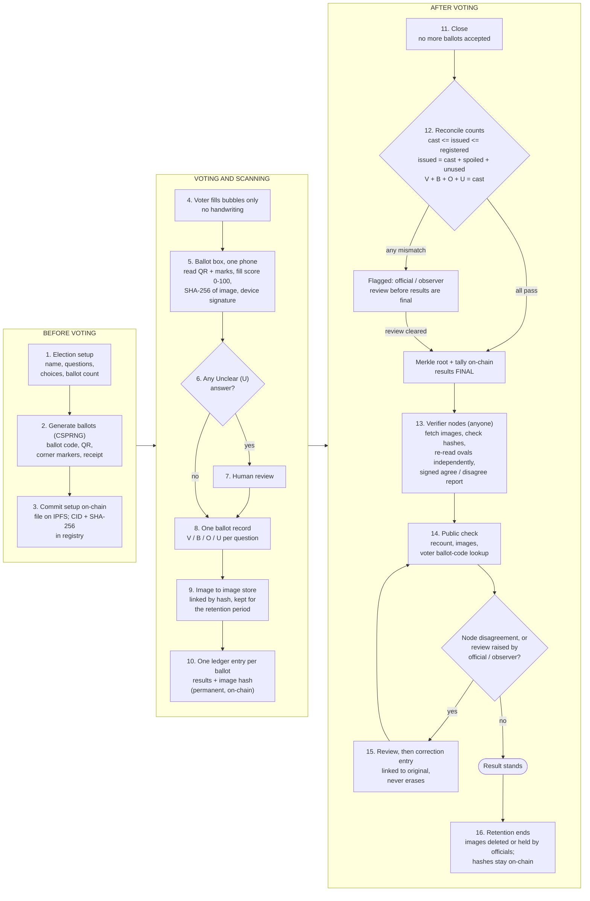

# B.E.I.N.G.S. Technical Design Specification

*Blockchain Election Integrity Network System — transparent voting, with a secret ballot*

> **DRAFT FOR DISCUSSION — v0.9, 31 October 2026 (architecture and data-flow companion document added).** Not a finished or audited design. Not legal advice, and not a claim of compliance with any election law or standard. Items marked **[OPEN]** are undecided; see Section 13. Author: :James-Hugh: Lamb., North Vancouver, BC (Canada-Verse podcast). Companion documents: *Classroom Pilot Plan* and *Strata Vote Pilot Plan*.

## 1. Plain-language introduction

**What is B.E.I.N.G.S.?** It is a way to run a vote on **paper** so that every voter can check their ballot was counted as they marked it, and anyone can recount the whole election, while the vote itself stays secret.

**How it works, in six sentences.**

1. The organizer sets up the election: its name, the questions and the choices, and how many ballots to print.
2. A program prints that many ballots. Each one has its own random **ballot code**, a QR code, corner markers and a tear-off receipt showing the same ballot code.
3. The organizer publishes the setup (as a file) and puts its fingerprint on a public blockchain, so the questions can never be quietly changed.
4. Voters fill in the pre-printed ovals (no writing), keep the receipt (it carries the ballot code), and drop the ballot into a box. A phone in the box photographs it and reads the marks.
5. Each ballot's result and a hash (fingerprint) of its photo are recorded permanently on the blockchain, and the photo itself is published to a separate image store for a limited time. At the close, the organizer also publishes the **counts** (registered voters, ballots issued, cast, spoiled and unused); the system checks that they add up, and the totals are locked on the blockchain.
6. Any voter can look up their ballot code and see how each of their answers was counted, and anyone can download the photos (while they are retained), recount, and compare. Anyone can also run a **verifier node** (Section 5) that re-reads every photo with its own software and publishes a signed report that agrees or disagrees with the posted result. Mistakes are fixed only by election officials or observers raising a review and adding a visible correction, never by erasing anything.

**Why neutral transparency?** In typical automatic tabulation (for example optical scan machines), the voter feeds the ballot in and has no way to see how it was read or counted. B.E.I.N.G.S. is built the other way around: **anyone can see each ballot's recorded result** (Valid, Blank, Overvote or Unclear for every question), together with the photo it was read from, and a voter can look up their own ballot by its code. Anyone can also check that the counts add up: the number of registered voters, ballots issued, ballots cast, spoiled and unused. The aim is not to prove how a person voted. It is that the process can be seen to have worked properly, by anyone, without taking the machines or the organizer on trust.

**Core principle: don't trust, verify (verifier nodes).** The model is **one scan, many verifiers**: each ballot is scanned once, and many independent parties then check that scan. The design assumes that the organizer, the phones and any single piece of software **may be wrong**. What makes it trustworthy is that **anyone can run a verifier node**: a program that downloads each ballot image, checks its fingerprint against the ledger, **re-reads the ovals with its own independent software**, compares the result with the posted record, re-adds the totals, and publishes a **signed report**. Verifier nodes cannot change anything. They make cheating and mistakes **visible**, and a disagreement sends the election to review by an official or observer (Section 5).

**Why a blockchain?** It is used as a public, append-only notice board that nobody (including the organizer) can edit after the fact. It holds **each ballot's results and the fingerprint (hash) of its image, permanently**, plus the totals, but no names, no images and not the questions themselves. The scanned **images are kept separately and only for a limited time** (Section 9.3). If a blockchain is not available (for example in a classroom), Section 14 shows a plain website-and-hash fallback.

**Key words used in this document**

| Word | Plain meaning |
|---|---|
| Hash (SHA-256) | A fingerprint of a file. Change one dot and the fingerprint changes completely. |
| Merkle root | One fingerprint that covers a whole list of records. Change any record and the root changes. |
| IPFS / CID | A public file store where each file's address (its CID) is derived from its contents. |
| Public key / private key | A key pair used for signatures. The public key is shown to everyone and verifies signatures. The private key signs and is never shared. |
| Device key | A key pair each scanning phone generates itself. |
| Quorum | The minimum number of registered phones that must sign matching results before a ballot record is accepted. Default 1 (one scan); more is an optional extra. |
| Image store | Where the scanned (redacted) ballot images are kept for a limited time: IPFS or another image database. Linked to the ledger only by the image's hash. |
| Image retention | How long the images are kept, set in the election file to follow the host's existing rules for scanned-ballot systems (Section 9.3). |
| Ballot code | The random code for one ballot (for example 4F9Q-7M2X-HT8B). It is printed on the ballot and on its receipt, and names that ballot's single ledger entry. |
| Count reconciliation | The checks made at the close: ballots cast, issued, spoiled and unused must add up, and must not exceed the registered voters or printed ballots (Section 8). A mismatch sends the election to official or observer review before results are final. |
| Verifier node | A program that anyone can run. It re-checks the images, re-reads the ballots with its own software, recomputes the totals and publishes a signed report. It cannot change records (Section 5). |
| Receipt | The tear-off stub the voter keeps, for personal verification: it shows the ballot code (and may list the answers) so the voter can look up how each answer was counted. It is for viewing only. Keep it private. |
| V / B / O / U | Valid, Blank, Overvote, Unclear: the four possible results for one question on one ballot (Section 7). |
| Correction entry | A new public entry that fixes a result by pointing at the original. The original stays. |

## 2. Goals, non-goals and assumptions

**Goals**

- **End-to-end checkable:** a voter can see that their ballot is in the count as marked; anyone can recount.
- **Secret ballot:** no voter names or other personal information (PII) anywhere in the system.
- **Paper is the official record:** the digital system is a transparent, redundant count, not a replacement for the paper.
- **Low cost and low tech:** cardboard box, an ordinary phone (one scan per ballot), open-source software, near-zero chain fees.
- **Never erase:** every dispute is resolved by adding entries linked to the original.

**Non-goals (version 1)**

- Not internet or remote voting. Voting happens in person on paper.
- No write-in answers. Ballots contain only pre-printed ovals.
- Not a certified voting system for statutory public elections. Pilots are classroom and strata-council scale.
- Not a voter-registration system. Who may vote is decided by the organizer outside the system.

**Assumptions and rough threat model**

- The organizer controls ballot stock and the room, and is **not fully trusted**: the design should make cheating detectable, not impossible.
- A phone may fail or be wrong. It is cross-checked afterwards by **independent verifier nodes** (Section 5), and a human reviews Unclear marks and disagreements. More than one phone per box is an optional extra.
- Observers and voters can compare paper, photos and the public record.
- A hostile party might try to coerce or bribe voters (Section 3.2; the receipt's purpose is decided in Section 4.1).

### 2.1 Election operations (deferred to the host's protocols)

B.E.I.N.G.S. covers the **count and the public record**. The day-to-day running of an election is done under the **host organization's regular election protocols**, and this design defers to them. In particular:

- **Voter check-in and eligibility:** the register, identity checks and one-ballot-per-voter control at the desk. (Only the resulting **counts** feed Section 8.)
- **Ballot custody:** printing, storage, seals, chain of custody, and the handling of the ballot box and spare ballots.
- **Device setup and logic and accuracy (L&A) testing:** preparing and testing phones and the scan app before the vote. (The approved app hash and device keys are then recorded in the election file.)
- **Accessibility:** assisted voting, alternative formats, languages and any other accommodations.
- **Certification:** any equipment approval or accreditation that the host or the law requires.
- **Audits:** post-election audits and canvass. (The public images and records are an input to these, not a replacement.)

B.E.I.N.G.S. adds to these protocols; it does not replace or weaken them.

## 3. Democratic principles

B.E.I.N.G.S. is designed against widely accepted principles of democratic elections. Three reference documents are used as a checklist:

- **ICCPR Art. 25** — International Covenant on Civil and Political Rights, Article 25(b): genuine periodic elections by universal and equal suffrage, held by secret ballot, guaranteeing the free expression of the will of the electors. Article 2(3) (effective remedy) is used for the right to appeal. (UN Human Rights Committee, *General Comment No. 25*, gives the authoritative reading.)
- **Venice Commission Code** — *Code of Good Practice in Electoral Matters* (CDL-AD(2002)023rev2-cor): universal, equal, free, secret and direct suffrage (guidelines I.1–I.5), plus procedural guarantees, including observation of elections (II.3.2) and an effective system of appeal (II.3.3).
- **CoE Rec(2017)5** — Council of Europe Committee of Ministers Recommendation CM/Rec(2017)5 on standards for e-voting (adopted 14 June 2017). It applies the same principles to electronic voting and adds requirements for verifiability, transparency and observation, accountability, and reliability and security.

*How these apply.* B.E.I.N.G.S. is a paper ballot with electronic counting and publication, so Rec(2017)5 applies by analogy (mainly its verifiability, observation and accountability standards). The references are used as design goals only. Paragraph-level references should be checked against the source texts before this table is quoted in public material.

### 3.1 Principle-to-feature mapping

| Principle | Source | B.E.I.N.G.S. feature | Status |
|---|---|---|---|
| **Universal suffrage** (everyone eligible can vote) | ICCPR 25(b); Venice I.1; Rec(2017)5 | The paper path is always available and needs no device, account or internet. Large-print ballots; assisted marking by a person of the voter's choice; optional touchscreen entry as an accessibility aid that prints or submits a standard ballot (Section 7.4). Eligibility is decided by the organizer's own rules, with no tech gate. | Designed. Tactile template **[OPEN]**. |
| **Equal suffrage** (one voter, one vote, equal weight) | ICCPR 25(b); Venice I.2; Rec(2017)5 | Fixed ballot count committed at setup. One unique random ballot code per ballot. The ledger rejects a second record for the same ballot code and refuses records beyond the printed count. Spoiled ballots are replaced and logged, never counted twice. Count reconciliation at the close (Section 8): cast ≤ issued ≤ registered (or printed), and issued = cast + spoiled + unused. | Designed. |
| **Secret ballot** | ICCPR 25(b); Venice I.4; Rec(2017)5 | No voter PII anywhere (chain, IPFS, files). Ballot codes are random and not recorded next to names at check-in. Published images are redacted, published in shuffled order with coarse times, and kept only for the retention period (Sections 3.2 and 9.3). | Designed. Small-group limits in 3.2. |
| **Free suffrage / coercion resistance** (voter forms and expresses own will; no vote buying) | ICCPR 25(b); Venice I.3 (I.3.1, I.3.2); Rec(2017)5 | No photographs of ballots by voters. No identifying marks or write-ins. The decided receipt model (one ballot = one ballot code = one receipt) is for **personal verification**, not for proving a vote. A third party could still look up a receipt if a voter shows it, so voters should keep it private (Section 4.1, Section 13 item 4). | **Partial.** Acceptable for low-stakes pilots only. |
| **Transparency and verifiability** | Venice I.3.2 (combating fraud); Rec(2017)5 (individual and universal verifiability) | Public election file, public per-ballot records (results and image hash, permanent on the ledger), images in an image store for the retention period, public Merkle root and tally. Individual: the voter looks up their ballot by the ballot code on the receipt and sees how each answer was counted, with the image (while it is retained) and its hash. The lookup is view-only. Universal: anyone recounts every ballot from the images and re-derives the tally, and **independent verifier nodes** (Section 5) do this automatically and publish signed agree/disagree reports and public metrics. | Designed. |
| **Accuracy and integrity of the count** | ICCPR 25(b); Venice I.3.2; Rec(2017)5 (reliability, security) | **One scan per ballot** by a registered phone; its reading is signed with a registered device key. SHA-256 hashes of images are on the ledger. (More phones per box are optional.) Explicit V/B/O/U results that sum to ballots cast. Approved app-version hashes. Human review of every disagreement or unclear mark. **Independent verifier nodes with their own reading software** re-check every ballot after posting (Section 5). | Designed. App attestation **[OPEN]**. |
| **Right to appeal and remedy** | ICCPR 2(3); Venice II.3.3; Rec(2017)5 | Election officials, reviewers and observers can raise a review of a ballot (voters do not flag through the system). Fixes are correction entries linked to the original, with a reason code and evidence. Nothing is erased, so the full history is auditable. Final authority rests with the body named by the organizer's rules (outside the system). | Designed. Appeal body is organizer-defined. |
| **Independent observation and audit** | Venice II.3.2; Rec(2017)5 (observation, audit) | Observers can watch the box and the counting. Public recount tooling and **anyone-can-run verifier nodes** (Section 5), including nodes run by observers, schools and candidates. **Paper stays the official record** and can be recounted by hand. Risk-limiting audit (RLA): a random sample of paper ballots checked by hand against the posted records, with the random seed generated in public (for example dice rolled in front of observers). | Designed. RLA tooling later. |
| **Accountability** | Rec(2017)5 (accountability) | The election file is hashed and the hash committed on-chain before the vote. The organizer's public key, device keys and app hashes are public. Every post is signed. Versioning keeps old files visible. | Designed. |

### 3.2 Transparency versus secrecy in small groups

Publishing every ballot makes recounts easy but creates a risk that grows as the group shrinks. In a class of 25 or a strata of 40 lots, people may know each other's handwriting, pens and habits. Known risks and the planned mitigations:

| Risk | Example | Mitigation |
|---|---|---|
| **Pattern voting** | On a ballot with many questions, a coerced voter is told to mark a specific unusual combination as a signature; the coercer then looks for that pattern in the public list. | Keep ballots short in small groups. Publish records in sorted or shuffled order, never scan order. **[OPEN]** high-risk mode: publish each question's results as a separate shuffled list so rows cannot be linked across questions (full ballots remain on paper). |
| **Identifying marks in images** | A distinctive pen, smudge, torn corner, stray doodle, fingerprint, or paper fibre in the published photo identifies the voter. | **Unmarked ballots** (no names, icons or serial marks other than the random ballot code). Standard supplied pens (Section 6). Phones **crop and blur everything except the bubble areas, the ballot code and the QR code** before publication; the redacted image is what is hashed and published (to the image store, for the retention period only). The raw image stays sealed with the scrutineer, with only its hash recorded. |
| **Timing and order metadata** | Scan order or timestamps line up with the order people were seen entering the room. | Round times to the whole event or day. Publish in sorted ballot-code order. Do not publish phone-by-phone scan logs. |
| **Small breakdowns** | Results by room, row or sub-group reveal a single person's vote. | **Minimum thresholds:** per-question totals are published only when at least *k* ballots are cast, and any sub-group breakdown only when the sub-group has at least *k* ballots (`minBreakdownSize`, default 10, configurable). |
| **Unanimous or tiny results** | If all 8 ballots say Yes, everyone's vote is known. | Cannot be fixed by technology. The organizer sets a **minimum electorate size** or accepts and explains the limit. State this in the pilot plan. |
| **Receipt plus public ballot record** | If a voter shows their receipt to someone, that person can look the ballot code up in the public list and see the answers. | The receipt is for personal verification. **Voters should keep it private.** Accepted for low-stakes pilots (Section 4.1 and Section 13 item 4). |

The privacy settings live in the election file (`privacy`, Section 11.1) so they are fixed and public before the vote. **Image retention limits the exposure of the images over time:** the scanned images are kept only for the configured period (`imageRetention`, Section 9.3), while the permanent ledger holds only results and image hashes. Copies that others have already downloaded cannot be recalled, so the redaction rules above remain the main protection.

## 4. End-to-end data flow



*Figure 1. Data flow from setup to review. Step numbers match the table below.*

| # | Step | What happens | Where the result lives |
|---|---|---|---|
| 1 | Election setup | Organizer enters the election name, the questions, the choices for each, the maximum marks per question, the V/B/O/U thresholds, privacy settings, open and close times, and the number of ballots to print (including spares). | Draft election file (local) |
| 2 | Generate ballots | A generator using a **cryptographically secure random number generator (CSPRNG)** creates, per ballot: **one random ballot code**, a QR code (ballot code and layout version), corner markers, and a tear-off receipt showing the same ballot code. Every ballot has the same question and choice layout; there are no per-answer codes. Ballot codes are checked for uniqueness and saved. | Print files; election file (ballot code list) |
| 3 | Commit setup | The election file is published to IPFS. Its SHA-256 and IPFS address (CID) are posted to the on-chain registry together with the organizer's public key and the phones' public keys. Phones are registered **before** the election opens. Status: Setup. | IPFS; ElectionRegistry |
| 4 | Voter marks | At check-in the voter gets one ballot (no ballot code is written next to a name). The voter fills the pre-printed ovals only, with no handwriting, tears off the receipt (ballot code, and optionally a copy of the answers), and puts the ballot face up into the box. See Section 6. | Paper |
| 5 | Phone reads | A camera-down phone in the box photographs the ballot (the organizer may add more phones; Section 5.6). It reads the QR code and measures a fill score from 0 to 100 for every bubble. It hashes its image with SHA-256, derives the V/B/O/U result per question, and **signs** the reading with its device key. | Phone (local) |
| 6 | Check before posting | The ballot code must be on the printed list and not already used. Any question with an **Unclear (U)** result goes to step 7. If extra phones are used, their results for **every** question must also be identical, or the ballot goes to step 7. | Box coordinator |
| 7 | Human review | Any Unclear (U) question, and any disagreement between optional extra phones, goes to a human reviewer who compares the paper with the image and records a decision and a reason. | Review log |
| 8 | Ballot record | The results for **all** questions are assembled into **one ballot record** for that ballot code, including the phone's signed reading (and the fill scores). | Ballot record (JSON) |
| 9 | Image to image store | The redacted image and the full ballot record file are uploaded to the **image store** (IPFS or another image database, as named in the election file). They are linked to the ledger **by hash only**. They are kept **temporarily**, for the retention period (Section 9.3). | Image store |
| 10 | Post to ledger | **One ledger entry per ballot permanently holds all of its answers and the image's SHA-256 hash** (and the hash of the full record). The image itself is not on the ledger. The contract accepts the entry only if the registered device(s) required by `quorum` (default 1) signed matching results. | BallotLedger (Flare) |
| 11 | Close | At the close time the organizer closes the election and the ledger accepts no more records. Officials stop issuing ballots and note the counts of ballots issued, spoiled (logged replacements) and returned unused. These are **counts only**. Status: Closed. | Registry; official counts |
| 12 | Reconcile and tally | The organizer posts the **Merkle root** of all final records, the tally (V/B/O/U per question) and the **reconciliation counts**: registered voters, printed, issued, cast, spoiled, unused. The Tally contract runs the checks of Section 8.3. If all pass, the results are **Final**. If any fails, they stay **Provisional** and the election is **flagged for official or observer review**. Status: Tallied. | Tally; tally file |
| 13 | Verifier nodes check | **Anyone** may run a verifier node (observers, schools, candidates, the public). Each node fetches every image from the image store and checks its hash against the ledger, **re-reads the ovals with its own software**, compares with the posted record, recomputes the tally, the reconciliation and the Merkle root, and publishes a **signed report** (agree or disagree, by ballot and question). Nodes cannot change records (Section 5). | Verifier report (IPFS); VerifierRegistry |
| 14 | Public verification | Anyone downloads the election file, the ledger records and (while retained) the images, recounts, and compares. Voters look up the ballot code from their receipt and see how each answer was counted (view only). The public metrics (number of independent nodes, agreement rate) are shown with the results. | Public |
| 15 | Review and corrections | A **verifier disagreement report**, or an election official, reviewer or observer, may lead to a review of a ballot or of the whole election, and the reviewer examines it. Any change is a **correction entry** linked to the original, with a reason code. The original is never erased. An amended tally is posted as a new version. | BallotLedger; Tally |
| 16 | Retention ends | When the retention period ends (and no review or recount is open), the images are **deleted or held by officials** under the host's records rules. The ledger entries and image hashes stay on-chain, so any retained copy can still be proven authentic. The organizer may post a public notice. | Image store; ElectionRegistry (notice) |

### 4.1 Receipt model (decided)

**Receipt for personal verification: look up your ballot code and see how each answer was counted.**

**One ballot = one ballot code = one receipt = one original ledger entry.**

- **Purpose.** The receipt exists for neutral transparency. The voter enters the ballot code and sees how each answer was recorded, with the image (while it is retained) and its hash, so that, if everything was performed properly, they can see their intended vote. It is **view-only**: there is no confirm, flag or dispute function for voters, and no secret on the receipt. It is not a way to prove a vote to anyone else.
- Each ballot has a single random **ballot code**. The same code is printed on the ballot, in its QR code, and on the tear-off **receipt**.
- The ledger holds **one entry per ballot**, keyed by the ballot code, containing the result for **every question** (Valid, Blank, Overvote or Unclear). There are no per-answer codes and no per-answer entries.
- The **receipt shows the ballot code**. It may also list the voter's answers (for example a carbonless copy of the marked answer area); this is optional and decided per election.
- Because all ballots share the same layout, a recorded **Valid** answer is stored as the **choice ID** from the election file (for example `V:c2`), and the interface shows the full choice text.
- **Review and corrections** are not started by voters through the system. They are raised by **election officials, reviewers and observers** (Section 12.2). Outside the system, a voter who notices a problem may tell an official or observer, who decides whether to raise a review.
- Voter validation (confirm or flag) was considered and set aside for now; it is recorded as a future idea in Appendix A.

> **Privacy note:** the public record lists answers by ballot code, so anyone who is shown a receipt could look up that ballot. Voters should therefore **keep their receipt private**. The receipt is not designed or intended as proof of a vote.

## 5. Verifier nodes (the core of the no-trust design)

> **Don't trust, verify.** Any person or group can run a **verifier node**. Nodes check the whole election **independently of the organizer, the phones and each other**, and publish **signed reports** that anyone can read. Nodes **cannot change records**.

### 5.1 Why verifier nodes

The organizer is not fully trusted, and neither is any phone or piece of software (Section 2). The paper ballots, the public images and the ledger give everyone the **material** to check the count. Verifier nodes make that checking **routine, independent and visible**: instead of hoping that someone downloads the photos and recounts, many parties do it and publish what they found. If the posted result is right, independent nodes agree. If it is wrong, whether by error or by cheating, the disagreement is public.

### 5.2 Who runs a node

**Anyone**: observers, schools and school boards, candidates and campaigns, parents, journalists, researchers, or members of the public. Running a node is **permissionless**: there is no approval step, and registration (Section 10.4) is optional. A node needs only the public data (the election file, the ledger records and the images in the image store). It needs **no secret and no special access**.

**Diversity is encouraged.** Each node operator should use **their own OMR (optical mark reading) build**, ideally written independently of the scanning app and of other nodes. A shared bug then shows up as a disagreement instead of being repeated everywhere. The marker rules and thresholds (Sections 6 and 7) and the election file define what a correct reading is, so independent builds can be compared.

### 5.3 What a node does

1. **Fetch and check the images.** For every ballot on the ledger, fetch the image from the image store and check that its SHA-256 matches the **image hash on the ledger**.
2. **Re-read the ovals.** Read every oval in the image **with the node's own OMR build** and derive the result for every question (**V, B, O or U**, Section 7) using the thresholds in the election file.
3. **Compare and report.** Compare each reading with the **posted record** and publish a **signed report**: **agree**, or **disagree** with the ballot code, the question and both results. Images that are missing, unreadable or fail the hash check are reported too.
4. **Recompute the totals.** Re-add the tally from the posted records, re-check the **count reconciliation** (Section 8), and recompute the **Merkle root**, and report whether each matches what was posted.

A node may check **every** ballot or a **random sample** (stating which in its report). Reports are public (Section 11.5).

### 5.4 What nodes cannot do, and what happens on a disagreement

- Nodes have **no write access** to the ElectionRegistry, BallotLedger or Tally. They can only publish reports. They **cannot change, add or delete** a ballot record, a result or a tally.
- A report is **evidence, not a verdict**. A node's reading might be the wrong one. A disagreement is therefore a **request for review**: an election official or observer looks at the paper ballot and the image, and follows the review and correction process (Section 12.2). Any change is a correction entry linked to the original, and the new tally is a new version.
- Where a ballot's result was set by **human review** (for example an Unclear ballot decided by the teacher), a node's different reading is expected, and the report shows it as a disagreement with a note that the record was reviewed.
- The more **independent** nodes agree with one another and disagree with the posted record, the stronger the evidence. A single disagreement on a single oval is usually a threshold or image issue; a pattern is a reason to look harder.

### 5.5 Public metrics

The following are published with the results (on the lookup page and in the tally file) and in the contract (Section 10.4):

- **Number of independent nodes** that published a report (distinct node keys; named operators are shown separately).
- **Agreement rate**: the share of ballot-questions checked by nodes where the node's reading agrees with the posted record, in total and for each node.
- **Coverage**: the share of ballots checked by at least one node, and by at least three nodes.
- **Open disagreements** and their status (under review, cleared, corrected).
- Whether the nodes' recomputed **tally, reconciliation and Merkle root** match.

*Caution.* Anyone can create many keys, so a raw node count can be inflated. The count is a rough indicator. Its value comes from **who** runs nodes and whether they are **genuinely independent** (different operators, different software), which is why optional named registration is useful.

### 5.6 The model: one scan, many verifiers

**Each ballot is scanned once, and many independent verifier nodes then check that scan.** This replaces the idea of relying on several phones agreeing in every box. With the paper ballots kept as the official record, and many nodes re-reading every public image with their own software, **one phone per box is enough**, because a wrong or dishonest reading will be seen by the nodes afterwards. Fewer phones also means a simpler, cheaper and more private setup (one image per ballot).

- **Default:** one registered phone per box (`quorum` = 1). The phone's signed reading and the image hash go on the ledger.
- **Optional:** an organizer may still add extra phones and require a higher `quorum` (up to 4), for example in a high-stakes vote. Extra phones **prevent** a wrong record being posted; verifier nodes **detect** one afterwards. Either or both may be used.
- **Why the nodes matter more in large elections:** in a large election the number of independent nodes, and how different they are, matters more than the number of phones.

### 5.7 Who secures what: Flare validators and verifier software

- **Flare validators secure the ledger.** They order and finalize transactions and keep the history of the chain tamper-resistant, so ballot results, image hashes, tallies and verifier reports cannot be quietly changed after posting.
- **Flare validators do not verify images.** They do not look at ballots, and they cannot tell whether a ballot was read correctly.
- **B.E.I.N.G.S. verifier software does the checking.** Our own **open-source verifier software** (and any independent builds) fetches the images, re-reads them, and **posts signed reports to Flare** (Section 10.4).
- **Possible future path (unverified): Flare Data Connector (FDC).** FDC is Flare's built-in oracle that attests external data to Flare contracts, with agreement from a majority of data providers. It might one day be used to bring a verifier's published report on-chain with provider attestation, for example through its Web2Json type, which fetches JSON from an approved web address. This has **not** been checked for fit (size and format limits, approved hosts, cost), and the providers would attest to what a report *says*, not to whether the images were read correctly. It is **not part of this design**.

### 5.8 Limits

- A node checks that the **image, the record and the totals agree**. It cannot show that the image is a faithful picture of the physical ballot; that is checked by **observers and the paper recount** (Section 3.1, Independent observation and audit).
- Nodes can only check while the images are **retained** (Section 9.3). After that, only the permanent ledger entries and image hashes remain, and a retained copy can still be proven authentic by its hash. Nodes are asked to keep their own copies only as long as the host's rules allow (this cannot be enforced).
- Nodes can only re-read what the **published (redacted) images** still show. The redaction rules must keep the ovals readable (Section 13, Redaction method).
- If **all** nodes share the same software or the same bug, they will agree with each other and with the phones. Independent builds help; they do not guarantee.
- Nodes see only public data and publish no identities. They do not check who was eligible to vote (Section 2.1).

## 6. Ballot marking standard

The voting mark is the one thing the voter does, so it must be simple, uniform and machine-readable. All paper choices are **pre-printed ovals, and the voter only fills them in. Nothing is ever written on the ballot.**

### 6.1 Printed layout

- **Ovals:** about **5–6 mm** across, one per choice, on a fixed grid with generous spacing (at least 8 mm between ovals) so a wide marker does not touch the neighbour.
- **Oval colour:** the oval outline is printed in **light grey (a drop-out colour)**, so the printed outline does not compete with the voter's mark and the fill score measures the voter's ink, not the printing. The reader measures each interior against the paper and printed-outline baseline.
- **Alignment features:** the **corner markers and the QR code are solid black**, so the phones can find, deskew and scale the page reliably.
- **Choice labels:** full words beside each oval (for example "Aquarium"). There are no per-answer codes.
- **Question and choice IDs [PROPOSED]:** each question heading starts with its ID (`Q1` for `q1`), and each oval has its choice ID (`c2`) printed small, in light grey, to the right of the oval, clear of the oval's scanning zone. These are the same IDs the ledger stores (`V:c2`, Section 7.1), so the voter can read what a recorded answer means straight off the paper ballot and the receipt lookup. They are not per-answer secrets (every ballot carries the same ones) and the scanner ignores them. The one **ballot code** is printed in the header of the ballot and repeated on the receipt.
- **Print quality:** use a laser printer or print shop, on plain matte, non-glossy paper (glare causes bad reads), with no background tints, watermarks or serial numbers beyond the random ballot code.
- **Lighting:** a steady white LED lamp inside the box. Avoid coloured lighting (it can make red ink vanish).

### 6.2 Marker rules (printed in the ballot instructions)

| Marker | Rule |
|---|---|
| **Supplied dark felt pen** | **Recommended.** Supplied at every voting station, so every ballot looks alike (also helps anonymity, Section 3.2). |
| Black or blue ballpoint | OK. |
| Pencil | Allowed, because some voters need it, but **light or erased marks will usually be read as Unclear (U)** and sent to human review. Press firmly and fill the oval. |
| Red, orange, yellow or other light inks; highlighters; gel inks that bleed | **Avoid.** Low contrast under camera and lamp. Risk of a misread or of an Unclear result. |
| Anything else (writing, ticks, crosses, circles) | Not valid marks. They will usually come out as Unclear and go to review, so avoid them. |

### 6.3 Correct and incorrect marks (examples printed on every ballot)

The ballot carries a small panel showing:

| Example | Mark | What the reader sees |
|---|---|---|
| **Correct** | Oval completely filled in, dark | High fill score, Valid (V). |
| Incorrect | A tick or a cross inside the oval | Partial fill, probably Unclear (U) → review. |
| Incorrect | A small dot or thin outline | Low or middle fill score → Blank or Unclear. |
| Incorrect | A circle drawn around the whole choice | Not read as a mark; the question may come out Blank (B). |
| Incorrect | Two ovals filled on a one-choice question | Overvote (O): that question does not count. |
| Incorrect | Marks outside the ovals, writing, names or initials | Ignored by the reader, but they may identify the voter and are redacted before publishing (Section 3.2). Do not do this. |
| Incorrect | Light pencil, or a mark that has been erased | Probably Unclear (U) → review. |

The printed instruction is: **"Fill in the oval completely. Do not write anything on this ballot."**

### 6.4 Spoiled ballots

The ballot also says: **"Spoiled it? Ask for a new ballot."**

- A voter who makes a mistake, or who is not sure the mark is clean, hands the ballot back to the poll official **instead of putting it in the box**, and receives a new ballot with a different ballot code.
- The official does not look at the marks. The spoiled ballot is put face down into a sealed spoiled-ballot envelope. It is **never scanned and never counted**.
- The spoil is **logged and replaced, not corrected**: the log records the spoiled ballot code, the replacement ballot code and the time (rounded). It has no name or other voter data. The ledger marks the spoiled ballot code as spoiled, so a record for it can never be accepted later.
- A spoiled ballot is not a "correction entry". Corrections (Section 12) apply only to ballots that were cast and read.
- Reconciliation at the close: **issued = cast + spoiled + unused**, and the counts are published and checked (Section 8).
- Optional organizer policy: limit the number of replacement ballots per voter (for example two), because repeated replacement could be used to show a coercer pre-marked ballots **[OPEN]**.

## 7. Result values and tally rules

### 7.1 The four result values

Every question on every cast ballot ends with exactly one of four results. Compact stored result codes are given with the full word used in the user interface; **the interface always shows the full word** (Valid, Blank, Overvote, Unclear), never just a letter.

| Code | Full word | Meaning | Counts toward a choice? |
|---|---|---|---|
| `V` | **Valid** | Between 1 and *maxMarks* clear marks. Stored with the choice ID(s) from the election file, for example `V:c2`. For a question with more than one allowed mark, IDs are joined with `+`, for example `V:c1+c3`. | Yes |
| `B` | **Blank** (undervote) | No clear mark on the question. | No |
| `O` | **Overvote** | More clear marks than *maxMarks*. This question does not count, but **the rest of the ballot still does**. | No |
| `U` | **Unclear** | At least one bubble is neither clearly empty nor clearly marked. **Sent to human review.** | Not until resolved |

### 7.2 Fill score and thresholds

Each phone computes a **fill score from 0 to 100** for every bubble (the percentage of the oval interior covered by ink, normalised against the printed baseline). The thresholds are set per election in the election file. **Example (configurable):**

| Fill score | Bubble state |
|---|---|
| Below 15 | Empty |
| 15 to 50 (inclusive) | Unclear |
| Above 50 | Marked |

**Deriving the question result.** Let *f* = number of marked bubbles, *u* = number of unclear bubbles, *m* = `maxMarks`.

1. If *f* > *m* → **O** (overvote), even if some bubbles are unclear, because the overvote cannot be undone by resolving them.
2. Else if *u* > 0 → **U** (unclear).
3. Else if *f* = 0 → **B** (blank).
4. Else → **V** with the choice IDs of the marked bubbles.

### 7.2.1 Three-threshold consensus

A batch is read **once**. The fill scores (0–100 per oval) are kept. Those same scores are then turned into a results string **three times**, with three threshold pairs. Nothing is scanned again.

| Pass | Name | emptyBelow | markedAbove | Meaning |
|---|---|---|---|---|
| A | tight | 10 | 55 | Only a dark oval counts as marked, and only a very light one counts as empty. |
| B | standard | the election's own `resultRules` | | The thresholds the election already uses. When the file does not set them, they are 15 and 50. |
| C | loose | 20 | 45 | A lighter oval can count as marked, and a darker one can still count as empty. |

The three pairs are optional in the election file, under `consensusThresholds` (`tight`, `standard`, `loose`). A missing pair uses the row above. `standard`, when set, replaces `resultRules` for pass B only. Each pair must keep `emptyBelow` ≤ `markedAbove` + 1, and both numbers are integers from 0 to 100. The check is the same one already used for `resultRules`.

For each pass the results string is derived with the rules in this section (Valid, Blank, Overvote, Unclear). Each ballot then becomes one Merkle leaf:

* **Key.** If every ballot in the batch has a code, the key is `keccak256` of the UTF-8 code (the on-chain ballot key). The code is used only for that hash. If the codes must stay private, or any ballot has no code, every key is the 32-byte `imageSha256` instead. One batch uses one kind of key. A tree keyed by ballot hashes is not the same tree as one keyed by image hashes.
* **Leaf.** `keccak256( key (32 bytes) || keccak256(UTF-8 results string) (32 bytes) )`.
* **Order.** Those leaves are sorted ascending by byte order before the tree is built. The tree is the same sorted-pair keccak tree as the ballot list: the parent is `keccak256(min || max)`, a leftover node is promoted unchanged, and the root of an empty list is 32 zero bytes. Scan order does not change the root. The written report lists ballots by key, ascending, which is also independent of scan order.

The three roots are compared.

* If they are equal, the batch **passes**. The marks are not sitting on a threshold, so a slightly tighter or looser rule would not change any result.
* If they differ, the report names **only** the ballots, questions and ovals that moved, with the fill score and the three bubble states (empty, unclear, marked). Each of those ballots is **flagged for a human look**, the same idea as an Unclear mark: a person compares the paper before anything is signed. The report never contains a ballot code. It identifies a sheet by its image hash and, at the station, by the page number.

The scanner helper runs this at the end of the batch reading step and prints the pass or the flag list **before** any signature. The verifier runs the same check with `beings-consensus`, and again beside a blind re-read, reusing the fill scores that read already produced. Both write `report.json` and a short summary. No second scan is done.

**Recording the three roots later (not built).** No deployed contract is changed by this check, and this design does not send a transaction. The roots are not written on-chain today. Later, the owner may record them without a new contract: `ElectionNotes` already stores the SHA-256 of an off-chain file, a pointer to where that file is kept, and the author's role. A note whose file is this consensus report (or just the three roots) would pin the roots. Posting a note cannot change counts, a failed check, or Final / Provisional. A future contract could store the three roots in one call. That contract is not written here. The owner decides later.

### 7.3 Resolving Unclear (U)

A reviewer compares the paper and the images and then posts a **correction entry** (Section 12) that changes the result with a **reason code**, for example `U → V:c2`, reason *faint mark*. The same applies if the reviewer decides the result is B or O. The original `U` entry stays visible. If a U cannot be resolved it remains U in the final tally and is not counted for any choice, and the tally says so.

### 7.4 Tally display

For each question the tally shows the number of **Valid, Blank, Overvote and Unclear** ballots, and these four counts **always sum to the number of ballots cast**. Valid is further broken down by choice. The contract checks the sum and flags any mismatch for review (Section 8); recounting the choices is done by the public (Section 12.1). Small-group publishing thresholds from Section 3.2 apply.

**Touchscreen entry (optional) [OPEN].** If an organizer offers a touchscreen mode (for accessibility), it should (a) show an **overvote warning before the voter submits**, and (b) possibly offer an explicit **Abstain** button that is recorded as Blank. Whether to include Abstain, and how it is stored so it cannot be told apart from a skipped question, are open questions (Section 13, item 5). Paper-only elections do not need it: a Blank is simply an unmarked question.

## 8. Count reconciliation

### 8.1 Purpose

A recount shows that each ballot was read correctly. It does not show that the **right number** of ballots exist. **Count reconciliation** is a second, simple check: at the close, the organizer publishes a handful of **counts** (registered voters, ballots issued, ballots cast, spoiled, unused) and the system checks that they agree with each other and with the ledger. A mismatch means ballots may have been added, lost or mishandled, so the election goes to official or observer review **before results are final**. The same idea is used in ordinary paper elections, where officials compare the number of voters with the number of ballots.

### 8.2 The counts

All counts are published **on the ledger and in the tally file at the close**. They are **counts only: no names, lot numbers or other identities** are published, and the register of voters stays with the organizer, offline.

| Count | Meaning | Source |
|---|---|---|
| **Registered voters** | Number of people (or lots, students) entitled to vote. 0 if the election has no register (open electorate); then the printed count is the ceiling. Fixed in the election file before the vote. | Organizer's register (count only); election file and registry |
| **Printed** | Ballots printed, including spares. | Election file (length of the ballot code list); registry |
| **Issued** | Ballots handed to voters at check-in, **including replacements** for spoiled ballots. | Official check-in counts (counts only) |
| **Cast** | Ballots with an accepted record on the ledger. | Read from the ledger |
| **Spoiled** | Ballots handed back and replaced (logged, Section 6.4). | Read from the ledger |
| **Unused or returned** | Issued ballots that were handed back unmarked or not cast, and **not** replaced. | Official counts |
| **Unissued** | Printed minus issued (spare ballots never handed out). | Calculated |

### 8.3 Rules

| Rule | Check | Why |
|---|---|---|
| **R1** | **cast ≤ issued** | More ballots counted than were handed out indicates added ballots. |
| **R2** | **issued − spoiled ≤ registered** (skipped when there is no register) | The number of voters served cannot exceed the number registered. Replacements are removed because they re-issue a ballot to the same voter. |
| **R3** | **issued ≤ printed** | Cannot hand out more ballots than were printed. |
| **R4** | **issued = cast + spoiled + unused** | Every ballot handed out is accounted for. |
| **R5** | **For every question: V + B + O + U = cast** | Every cast ballot has exactly one result per question (Section 7.4). |
| **R6** | **registered (at close) = registered in the election file** | The register count was not changed after the vote began. |

Together, the first three rules give **cast ≤ issued ≤ registered** (or printed, when there is no register), with the spoiled replacements taken into account in R2.

*Worked example.* 120 registered, 130 printed. 123 ballots handed out (including 3 replacements), 119 cast, 3 spoiled, 1 returned unused: R1 passes (119 ≤ 123), R2 passes (120 ≤ 120), R3 passes (123 ≤ 130), R4 passes (123 = 119 + 3 + 1), R5 passes (every question sums to 119), R6 passes.

### 8.4 When a check fails

- The Tally contract **does not hide or reject** a mismatch. It records the result as **Provisional**, lists which rules failed, and emits a **review required** event (Section 10.3).
- The election is **flagged for review by an election official or an observer** before the results are final. They look for the cause (a miscounted check-in tally, a ballot taken away, a ballot missing from the box, an error in a record) and may recount the paper or post correction entries (Section 12.2).
- A registered reviewer **clears** the review, recording the evidence and the reason (evidence file in the image store for the retention period; its hash on-chain), and the results become **Final**. The failed checks and the clearance both **stay on the public record**.
- A corrected result is posted as an **amended tally**, which runs the checks again.
- Some mismatches have innocent causes, such as a voter leaving with a ballot. The aim is that they are **seen, explained and recorded**, not that every election is perfect.

### 8.5 Limits

- Matching counts show the numbers are **consistent**. They do not show that each ballot was read correctly; that is the job of the public recount (Section 12.1).
- The **registered voters** and **issued** counts are only as reliable as the register and the check-in counts. Two independent counters (one held by an observer) are recommended.
- No identities are published. Reconciliation therefore cannot show that each registered person voted once; it shows only that the totals are consistent.
- In a very small election, publishing exact counts may reveal who did not vote. The small-group thresholds of Section 3.2 apply.

## 9. Storage, keys and versioning

**The short answer to "where do the questions live, and are the election code and key on-chain?"** The questions, choices and rules live in a **JSON election file on IPFS** (public file storage), not on the blockchain. The blockchain (Flare) holds a small **registry entry**: the **election code**, the file's **IPFS address (CID)**, the file's **SHA-256 hash**, the organizer's and phones' **public keys**, and the election status. It also holds, **permanently, each ballot's results and the hash of its image**. The **scanned images themselves are kept in a separate image store, only for a limited time** (Sections 9.2 and 9.3). Private keys are never on-chain and never in a shared file.

### 9.1 What lives where

| Item | Public files (IPFS) | On-chain (Flare, permanent) | Image store (temporary) / offline |
|---|---|---|---|
| Election code (e.g. `BEINGS-2026-K7M4Q2`) | Yes (inside the file) | **Yes** (registry key, hashed to `bytes32`; the readable string is in an event) | |
| Election name, questions, choices, max marks | **Yes** | No | |
| V/B/O/U rules and thresholds | **Yes** | No | |
| `imageStore` and `imageRetention` settings | **Yes** (in the election file) | Covered by the file's hash | |
| Ballot layout hash (`layoutHash`, SHA-256 of the layout file) | **Yes** (in the election file) | Covered by the file's hash, so the layout the scanners use is fixed on-chain | |
| Ballot code list | **Yes** | Optional Merkle root of the list | |
| **Ballot results** (all questions, per ballot) | | **Yes, permanent** (BallotLedger) | |
| **Image SHA-256** (per ballot) | | **Yes, permanent** (BallotLedger) | |
| Full ballot record file (fill scores, signatures) | | Its SHA-256 only | **Image store, for the retention period** |
| Scanned (redacted) ballot image | | Its SHA-256 only | **Image store, for the retention period** |
| Review evidence (reviewer notes, paper photos) | | Its SHA-256 only | **Image store, for the retention period** |
| Verifier reports (signed) | **Yes** (report file) | **Yes** (event with report CID and hash) | Nodes publish their own copies; anyone can mirror them |
| Tally file and reconciliation counts | **Yes** (tally file) | **Yes** (Tally contract) | Check-in tallies kept by officials and observers |
| Registered voter **count** (no identities) | **Yes** | **Yes** (registry) | The register itself stays with the organizer, offline |
| Approved app-version hashes | **Yes** | Referenced by hash of the file | |
| Open and close times | **Yes** | Yes (enforced by contracts) | |
| IPFS CID of the election file | | **Yes** | |
| SHA-256 of the election file | Computed from it | **Yes** | |
| Organizer **public** key | Yes | **Yes** | |
| Device **public** keys | Yes | **Yes** | |
| Status (setup / open / closed / tallied) | | **Yes** | |
| Organizer **private** key | | Never | **Hardware wallet, kept offline** |
| Device **private** keys | | Never | **Generated on each phone, never leave it** |
| Voter names, lot numbers, student names, any PII | **Never** | **Never** | Check-in list stays with the organizer, not linked to ballot codes |

### 9.2 Ballot data on Flare, images in a separate image store

- **Flare (permanent):** for every ballot, the **ballot code, the results for every question and the image's SHA-256 hash**, plus corrections, tallies, reconciliation counts and verifier-report notices. **Flare validators secure this ledger** (Section 5.7). They do not look at images.
- **Public files (IPFS, permanent, small, no images):** the election file, the tally file and the verifier reports.
- **Image store (temporary):** the redacted ballot images, the full ballot record files (fill scores, signatures) and any review evidence. The organizer chooses the store and names it in the election file (`imageStore`): **IPFS, or another image database or file store**. For a store where deletion must be possible, use a pinning service the organizer controls (unpin when the period ends) or an ordinary image database or object store.
- **Linked by hash, not by address:** the ledger holds only the **SHA-256 hash** of each image. The location (a CID or web address) is a non-authoritative hint. Anyone who has a copy, from any source and at any time, can check it against the on-chain hash.
- **Why split:** (1) **privacy**: images may carry identifying marks, so they should not stay public forever; (2) **cost and size**: images are large and the chain should hold only small facts; (3) **records rules**: how long ballot images must or may be kept is set by the host's rules, not by this design; (4) **nothing is lost**: the permanent ledger already holds the results, so the count never depends on the images being kept.

### 9.3 Image retention

- **Configurable in the election file** (`imageRetention`, Section 11.1): the setting should **follow whatever the existing laws and rules require for the scanned-ballot systems currently used in that jurisdiction**. It is **optional and set per situation and per area**: a host with no rule, or a pilot, may choose its own period. B.E.I.N.G.S. does not set legal retention periods.
- **What it says:** the basis (a jurisdiction's law, or the organizer's own policy), an optional reference to the rule, the **number of days** the images are kept after the results become Final, and what happens afterwards (**delete**, or **officials hold** the images under their records rules).
- **The clock extends while a review, recount or dispute is open**: images are not removed until it is closed.
- **What verifiers and voters can do:** while the images are retained, verifier nodes check them (Section 5.3) and voters see the image on the lookup page. After retention, the lookup page still shows the **results and the image hash**, and notes that the image is no longer available.
- **After retention:** the images may be **deleted** or **held by officials** per records rules. The **hashes stay on-chain**, so any retained copy (held by officials, an observer, a node) can be **proven authentic** by hashing it and comparing. The organizer may post a public notice (`noticeImagesRetired`, Section 10.1).
- **Limits:** copies already downloaded by others cannot be recalled, so the redaction rules (Section 3.2) remain the main privacy protection. The retention period limits what the host keeps hosting.
- **Classroom:** picks a **short window** (for example 14 days after the results are final), then deletes.
- **Paper:** the paper ballots are the official record and follow the host's own rules; this setting covers only the digital images and record files.

### 9.4 Why a file on IPFS, plus a hash on-chain

- **Cost and size:** questions, choices and a ballot list can be many kilobytes. Storing that on-chain would cost far more than a 32-byte hash and gives no extra security.
- **Tamper evidence:** the on-chain SHA-256 and CID make the file's contents public and fixed. Any change to a question changes the hash and is detectable by anyone.
- **Why both a CID and a SHA-256:** the CID is derived from IPFS's chunking and may not equal a plain SHA-256 of the file. The separate SHA-256 lets any browser verify the file with a standard hash tool.
- **Availability:** IPFS keeps a file only while someone pins it. Pin with at least two providers, keep a copy on GitHub or the election's website, and keep a paper copy of the hash at the event. Anyone can check any copy against the on-chain hash.
- **No deletion:** content on IPFS cannot be reliably removed, so only small public files (the election file, tally file and reports) go there by default, and **nothing sensitive (including raw images, Section 3.2) is ever uploaded**. The scanned images go to the image store (Section 9.2), which can delete them.

### 9.5 Keys

- **Organizer key:** a keypair on a **hardware wallet kept offline**. Only its public key (as an EVM address) is on-chain. It signs a handful of transactions per election: create, register devices, open, close, tally. No hot server holds this key.
- **Device keys:** each phone **generates its own keypair** (secp256k1, so signatures can be verified on-chain with `ecrecover`) in secure hardware (Android Keystore or iOS Secure Enclave) where available. The phone shows its public address as a QR code. The organizer **registers it before the election opens**. Who is allowed to approve registrations is **[OPEN]** (Section 13, item 2).
- **Reviewer keys:** human reviewers have keys registered the same way, for signing review decisions and corrections.
- **Gas:** phones sign off-chain messages and do not pay gas. A relayer (any account, for example the box's coordinating laptop) submits batches.
- **Only public keys on-chain.** There is no key escrow or recovery: a lost organizer key is handled by a documented process outside the system (for example a pre-agreed backup hardware wallet).

### 9.6 Versioning

The election file has a `version` number and may point to the `supersedes` CID of the previous version. Changes before opening are posted as a **new version** with a new CID and hash. **Old versions stay visible** and are listed in the registry, so anyone can see what changed and when. After the election opens the file is **frozen**: further changes are not accepted by the contracts. A post-open correction to the setup is only possible as a clearly flagged amendment under the organizer's rules **[OPEN]**.

### 9.7 Identifiers

- **Election code:** `BEINGS-<year>-<6 random characters>`, characters from the Crockford base-32 alphabet (digits and letters without I, L, O, U). The registry rejects duplicates. The on-chain key is `keccak256(bytes(electionCode))`.
- **Ballot code:** 12 random Crockford base-32 characters (60 bits) from a CSPRNG, shown as groups of four (for example `4F9Q-7M2X-HT8B`), checked for uniqueness. It is the only per-ballot code and is printed on the ballot and the receipt. The on-chain key is `keccak256(bytes(ballotCode))`.
- **Choice ID:** `c1`, `c2`, ... per question, as defined in the election file. The same on every ballot; not secret and not printed as a code.
- **Hashes:** **SHA-256** for files and images (browsers can verify it). **keccak256** for on-chain structures and Merkle trees (EVM-native). **RFC 8785 (JCS)** canonical JSON is used wherever JSON is hashed.

## 10. Smart contracts (sketch)

Target: **Solidity** on an **EVM** chain, with **Flare** as the first choice (low fees, EVM-compatible). Alternatives: an Ethereum layer 2, or Ethereum for anchoring the final root only. Three contracts: **ElectionRegistry**, **BallotLedger** and **Tally**. The code below is a *sketch for discussion*: it is not compiled, optimised or audited. **FTSO** (Flare's decentralised price oracle) is **optional** and not needed for any core function. Possible uses are showing fees in local currency, or a public randomness source for audit sampling; check current Flare documentation before relying on either.

### 10.1 ElectionRegistry

Holds the registry entry, the version history, the roles and the status.

```solidity
// SPDX-License-Identifier: MIT
pragma solidity ^0.8.24;

contract ElectionRegistry {
    enum Status { None, Setup, Open, Closed, Tallied }
    enum Role   { None, Device, Reviewer }

    struct Version { string cid; bytes32 fileSha256; uint64 postedAt; }

    struct Election {
        address organizer;       // address of the hardware-wallet key (public key hash)
        Status  status;
        uint32  ballotCount;     // printed ballots incl. spares; hard cap
        uint32  registeredVoters; // count only, no identities; 0 = no register used
        uint8   quorum;          // min matching device signatures per record
        uint64  opensAt;
        uint64  closesAt;
        bytes32 ballotListRoot;  // Merkle root of ballot codes in the file
    }

    mapping(bytes32 => Election)                    public elections;  // key = keccak256(electionCode)
    mapping(bytes32 => Version[])                   private versions;  // append-only
    mapping(bytes32 => mapping(address => Role))    public roles;
    mapping(bytes32 => uint8)                       public deviceCount;
    address public ledger;  // BallotLedger, set once
    address public tally;   // Tally, set once

    event ElectionCreated(bytes32 indexed key, string electionCode, address indexed organizer);
    event VersionPosted(bytes32 indexed key, uint256 index, string cid, bytes32 fileSha256);
    event DeviceRegistered(bytes32 indexed key, address indexed device, bytes32 appHash);
    event ReviewerRegistered(bytes32 indexed key, address indexed reviewer);
    event StatusChanged(bytes32 indexed key, Status from, Status to);
    event ImagesRetired(bytes32 indexed key, uint64 at, string noteCid);   // optional public notice that the image store was cleared or handed to officials

    function createElection(
        string calldata electionCode, string calldata cid, bytes32 fileSha256,
        uint32 ballotCount, uint32 registeredVoters, uint8 quorum, uint64 opensAt, uint64 closesAt,
        bytes32 ballotListRoot
    ) external;                                           // anyone; caller becomes organizer; code must be unused

    function postVersion(bytes32 key, string calldata cid, bytes32 fileSha256) external;      // organizer; Setup only
    function registerDevice(bytes32 key, address device, bytes32 appHash) external;           // organizer; Setup only
    function registerReviewer(bytes32 key, address reviewer) external;                        // organizer; Setup only
    function openElection(bytes32 key) external;          // organizer; needs deviceCount >= quorum, now >= opensAt
    function closeElection(bytes32 key) external;         // organizer; or anyone after closesAt + grace
    function markTallied(bytes32 key) external;           // Tally contract only
    function noticeImagesRetired(bytes32 key, string calldata noteCid) external;   // organizer; after the retention period; changes nothing else
    function latestVersion(bytes32 key) external view returns (Version memory);
    function versionCount(bytes32 key) external view returns (uint256);
}
```

### 10.2 BallotLedger

Accepts one record per ballot when enough registered devices agree, and keeps correction entries and spoil marks.

```solidity
contract BallotLedger {
    // EIP-712 typed data signed off-chain by each phone for each ballot
    //   Reading(bytes32 electionKey, bytes32 ballotKey, bytes32 resultsHash,
    //           bytes32 imageSha256, bytes32 scoresHash)
    struct Reading {
        address device;
        bytes32 imageSha256;   // hash of the redacted image this phone produced
        bytes32 scoresHash;    // keccak256 of the canonical fill-score table
        bytes   sig;           // EIP-712 signature by `device`
    }

    struct Submission {
        bytes32  electionKey;
        bytes32  ballotKey;       // keccak256(ballotCode)
        string   results;         // all answers in question order, e.g. "V:c1|V:c2" (stored permanently)
        bytes32  imageSha256;     // SHA-256 of the published redacted image (stored permanently)
        bytes32  recordSha256;    // SHA-256 of the full ballot record JSON (fill scores, signatures)
        Reading[] readings;       // one per phone; imageSha256 must equal one of them
        address  reviewer;        // zero address if no human review
        bytes    reviewerSig;     // reviewer signs keccak256(results) for Unclear (or differing) results
    }

    // Permanent on-chain ballot data: results + image hash (the images themselves are NOT stored here)
    struct Record { string results; bytes32 imageSha256; bytes32 recordSha256; uint64 acceptedAt; bool reviewed; }

    enum Reason { None, FaintMark, Erasure, StrayMark, GlareOrAlignment, PhoneMisread, Other }

    struct Correction {
        bytes32 ballotKey;
        uint32  prevIndex;       // index of the entry this one replaces in the chain; 0 = original record
        uint8   questionIndex;
        string  fromResult;      // the previous result string, e.g. "U"
        string  toResult;        // the new result string, e.g. "V:c2"
        Reason  reason;
        bytes32 evidenceSha256;  // hash of the reviewer note or paper photo (kept in the image store for the retention period)
        address by;
        uint64  at;
    }

    mapping(bytes32 => mapping(bytes32 => Record))     public records;       // electionKey => ballotKey
    mapping(bytes32 => uint32)                         public recordCount;
    mapping(bytes32 => mapping(bytes32 => bool))       public spoiled;
    mapping(bytes32 => uint32)                         public spoiledCount;
    mapping(bytes32 => Correction[])                   public corrections;   // append-only
    mapping(bytes32 => mapping(bytes32 => mapping(uint8 => uint32))) public head; // latest correction per question

    event BallotAccepted(bytes32 indexed electionKey, bytes32 indexed ballotKey, string results,
                         bytes32 imageSha256, bytes32 recordSha256, bool reviewed);
    event CorrectionPosted(bytes32 indexed electionKey, bytes32 indexed ballotKey, uint32 index,
                           uint32 prevIndex, uint8 questionIndex, string fromResult, string toResult,
                           Reason reason, bytes32 evidenceSha256);
    event BallotSpoiled(bytes32 indexed electionKey, bytes32 indexed ballotKey, bytes32 replacedByKey);

    /// Reverts unless: election Open; ballot not already recorded or spoiled; recordCount < ballotCount;
    /// readings are from distinct Device-role addresses with valid EIP-712 signatures; and either
    ///  (a) at least `quorum` readings (default 1) sign a resultsHash equal to keccak256(results), or
    ///  (b) a registered reviewer signed keccak256(results) and at least one valid reading is included.
    function submitRecord(Submission calldata s) external;
    function submitBatch(Submission[] calldata batch) external;      // offline sync, one transaction

    /// Reviewer or organizer only. `prevIndex` must equal head[...] so corrections form a chain.
    function postCorrection(Correction calldata c) external;

    /// Organizer or reviewer. Spoiled ballots cannot later be recorded.
    function markSpoiled(bytes32 electionKey, bytes32 ballotKey, bytes32 replacedByKey) external;

    function correctionCount(bytes32 electionKey) external view returns (uint256);
}
```

*What is permanent.* The ledger entry keeps, **permanently**, the ballot's **results** and the **image hash**. Images and the full record file live in the image store for the retention period (Section 9.3). A copy of an image that is retained by anyone, at any time, can be checked against the on-chain hash.

*Policy note.* The contract enforces a **minimum quorum** (default 1). If an organizer adds extra phones, the scanning app applies a **stricter policy**: *any* disagreement between phones is sent to human review rather than accepted by majority.

### 10.3 Tally

Posts the Merkle root, the results and the **reconciliation counts** at close, runs the reconciliation checks (Section 8.3), and supports inclusion proofs.

```solidity
contract Tally {
    struct QuestionTally { uint32 valid; uint32 blank; uint32 overvote; uint32 unclear; }

    // Counts only. No identities.
    struct Reconciliation {
        uint32 registered;       // registered voters; must equal the registry value (0 = no register used)
        uint32 printed;          // from the registry (ballotCount)
        uint32 issued;           // ballots handed out, including replacements (organizer, from check-in counts)
        uint32 cast;             // read from the ledger: recordCount
        uint32 spoiled;          // read from the ledger: spoiledCount (logged replacements)
        uint32 unusedReturned;   // issued, returned unmarked, not cast and not replaced (organizer)
        uint32 unissued;         // printed - issued
    }

    enum Finality { Provisional, Final }

    // failedChecks is a bit mask; 0 = every check passed
    //   1  R1  cast <= issued
    //   2  R2  issued - spoiled <= registered   (skipped when registered == 0)
    //   4  R3  issued <= printed
    //   8  R4  issued == cast + spoiled + unusedReturned
    //   16 R5  for every question: valid + blank + overvote + unclear == cast
    //   32 R6  registered == the registry's registeredVoters
    struct Result {
        uint32  version;          // 1 = original; higher = amended tally after corrections
        bytes32 merkleRoot;       // over final records (leaf = keccak256(JCS(final record with corrections applied)))
        Reconciliation recon;
        uint8   failedChecks;
        Finality finality;        // Final only if failedChecks == 0 or a review was cleared
        address clearedBy;        // reviewer who cleared a flagged result; zero otherwise
        string  clearanceCid;     // IPFS: evidence and reason for the clearance
        string  resultsCid;       // IPFS: full tally file incl. per-choice counts (Section 11.4)
        bytes32 resultsSha256;
        uint64  postedAt;
    }

    mapping(bytes32 => Result[]) public results;    // append-only history per election
    mapping(bytes32 => mapping(uint32 => mapping(uint8 => QuestionTally))) public perQuestion; // key => version => question

    event TallyPosted(bytes32 indexed electionKey, uint32 version, bytes32 merkleRoot,
                      uint32 issued, uint32 cast, uint32 spoiled, uint32 unusedReturned,
                      uint8 failedChecks, Finality finality, string resultsCid);
    event ReviewRequired(bytes32 indexed electionKey, uint32 version, uint8 failedChecks);
    event ReviewCleared(bytes32 indexed electionKey, uint32 version, address indexed reviewer, string clearanceCid);

    /// Organizer only; election must be Closed. `cast` and `spoiled` are read from the ledger, not supplied.
    /// Computes failedChecks. Does not revert on a mismatch: it stores the result as Provisional,
    /// emits ReviewRequired, and leaves the mismatch public. Status becomes Tallied.
    function postTally(bytes32 electionKey, bytes32 merkleRoot, QuestionTally[] calldata perQ,
                       uint32 registered, uint32 issued, uint32 unusedReturned,
                       string calldata resultsCid, bytes32 resultsSha256) external;

    /// Registered Reviewer (an election official or observer co-signer) only. Marks a Provisional result Final
    /// and records who cleared it and the evidence. The failed checks stay on the record.
    function clearReview(bytes32 electionKey, uint32 version, string calldata clearanceCid) external;

    /// After corrections: posts version + 1 and re-runs the checks; earlier versions remain readable.
    function postAmendedTally(bytes32 electionKey, bytes32 merkleRoot, QuestionTally[] calldata perQ,
                              uint32 registered, uint32 issued, uint32 unusedReturned,
                              string calldata resultsCid, bytes32 resultsSha256) external;

    function isFinal(bytes32 electionKey) external view returns (bool);   // latest version is Final

    function verifyInclusion(bytes32 electionKey, uint32 version, bytes32 leaf, bytes32[] calldata proof)
        external view returns (bool);   // OpenZeppelin-style sorted-pair MerkleProof
}
```

*What the contracts do and do not check.* The contracts enforce **who** may post, **when** (status and times), **how many** (the ballot cap and the no-duplicates rule) and **that devices agree**. At the close they also **run the reconciliation checks and record any failure publicly**, so a mismatch cannot be hidden and the results are not Final until the review is cleared. They cannot judge whether a posted choice is *right*; that is checked by the **public recount** from the images and records (Section 12.1). Per-ballot records cost on the order of 100,000–200,000 gas each (a rough estimate to be measured on Flare); batching is discussed in Open Question 1.

### 10.4 VerifierRegistry (optional hook for verifier nodes)

A **separate contract** with **no write path** into the ElectionRegistry, BallotLedger or Tally. **Registration is optional and permissionless**: any address can post a verification report whether or not it registered. Registration only lets an operator attach a name and an information file.

```solidity
contract VerifierRegistry {
    struct Node { string name; string infoCid; uint64 registeredAt; }   // optional, self-declared
    mapping(address => Node) public nodes;

    struct Metrics {
        uint32 nodeCount;               // distinct addresses that reported on this election
        uint32 nodesAllAgree;           // nodes whose latest report has no disagreements
        uint32 nodesWithDisagreement;   // nodes whose latest report lists at least one
        uint64 ballotQuestionsChecked;  // sum over each node's latest report
        uint64 ballotQuestionsAgreed;   // agreement rate = agreed / checked
    }
    mapping(bytes32 => Metrics) public metrics;          // electionKey => public metrics

    event NodeRegistered(address indexed node, string name, string infoCid);
    event VerificationReported(
        bytes32 indexed electionKey, address indexed node, uint32 tallyVersion,
        string reportCid, bytes32 reportSha256,        // the full signed report on IPFS (Section 11.5)
        uint64 ballotQuestionsChecked, uint64 ballotQuestionsAgreed,
        bool tallyMatches, bool reconciliationMatches, bool merkleMatches
    );

    /// Optional. Anyone. Re-registering updates the name and info file.
    function register(string calldata name, string calldata infoCid) external;

    /// Anyone. msg.sender is the node. A node's later report for the same election replaces its earlier
    /// one in `metrics`; all reports stay in the event log.
    function reportVerification(
        bytes32 electionKey, uint32 tallyVersion, string calldata reportCid, bytes32 reportSha256,
        uint64 ballotQuestionsChecked, uint64 ballotQuestionsAgreed,
        bool tallyMatches, bool reconciliationMatches, bool merkleMatches
    ) external;
}
```

A report with a disagreement (`ballotQuestionsAgreed < ballotQuestionsChecked`, or a `false` match flag) is a **request for review** by an official or observer (Section 12.2). The contract itself changes nothing. Individual disagreements (which ballot, which question) are in the report file, not on-chain, to keep the cost low.

## 11. JSON schemas

All JSON is hashed in its RFC 8785 canonical form. Schemas use JSON Schema draft 2020-12. Identifier patterns: **election code** `BEINGS-YYYY-XXXXXX`, **ballot code** 12 characters of the Crockford base-32 alphabet, **choice ID** `c1`, `c2`, ... per question.

### 11.1 Election file

```json election-schema
{
  "$schema": "https://json-schema.org/draft/2020-12/schema",
  "$id": "https://example.org/beings/election-file.schema.json",
  "title": "B.E.I.N.G.S. election file (draft)",
  "type": "object",
  "required": ["schemaVersion", "electionCode", "version", "name", "organizerPublicKey",
               "questions", "resultRules", "privacy", "registeredVoters", "ballotCodes",
               "approvedAppHashes", "quorum", "opensAt", "closesAt"],
  "additionalProperties": false,
  "properties": {
    "schemaVersion": { "const": "0.1" },
    "electionCode":  { "type": "string", "pattern": "^BEINGS-[0-9]{4}-[0-9A-HJKMNP-TV-Z]{6}$" },
    "version":       { "type": "integer", "minimum": 1 },
    "supersedes":    { "type": "string", "description": "IPFS CID of the previous version" },
    "name":          { "type": "string", "minLength": 1, "maxLength": 200 },
    "organizerPublicKey": { "type": "string", "pattern": "^0x[0-9a-fA-F]{40}$",
                            "description": "EVM address of the organizer's hardware-wallet key" },
    "deviceAddresses": { "type": "array", "uniqueItems": true,
                         "items": { "type": "string", "pattern": "^0x[0-9a-fA-F]{40}$" } },
    "questions": {
      "type": "array", "minItems": 1,
      "items": {
        "type": "object",
        "required": ["id", "text", "maxMarks", "choices"],
        "additionalProperties": false,
        "properties": {
          "id":       { "type": "string", "pattern": "^q[0-9]{1,3}$" },
          "text":     { "type": "string", "minLength": 1 },
          "maxMarks": { "type": "integer", "minimum": 1 },
          "choices": {
            "type": "array", "minItems": 2,
            "items": {
              "type": "object",
              "required": ["id", "text"],
              "additionalProperties": false,
              "properties": {
                "id":   { "type": "string", "pattern": "^c[0-9]{1,3}$" },
                "text": { "type": "string", "minLength": 1 }
              }
            }
          }
        }
      }
    },
    "resultRules": {
      "type": "object",
      "required": ["emptyBelow", "markedAbove", "results"],
      "additionalProperties": false,
      "properties": {
        "emptyBelow":  { "type": "integer", "minimum": 0, "maximum": 100, "description": "score < this = empty" },
        "markedAbove": { "type": "integer", "minimum": 0, "maximum": 100, "description": "score > this = marked" },
        "results": { "const": ["V", "B", "O", "U"] },
        "abstainButton": { "type": "boolean", "default": false }
      }
    },
    "consensusThresholds": {
      "type": "object",
      "additionalProperties": false,
      "description": "Optional. Three fill-score pairs for the consensus re-read of the same scans. A missing pair uses the default: tight emptyBelow 10 / markedAbove 55, standard = this file's resultRules, loose emptyBelow 20 / markedAbove 45.",
      "properties": {
        "tight":    { "type": "object", "additionalProperties": false, "required": ["emptyBelow", "markedAbove"],
                      "properties": { "emptyBelow": { "type": "integer", "minimum": 0, "maximum": 100 }, "markedAbove": { "type": "integer", "minimum": 0, "maximum": 100 } } },
        "standard": { "type": "object", "additionalProperties": false, "required": ["emptyBelow", "markedAbove"],
                      "properties": { "emptyBelow": { "type": "integer", "minimum": 0, "maximum": 100 }, "markedAbove": { "type": "integer", "minimum": 0, "maximum": 100 } } },
        "loose":    { "type": "object", "additionalProperties": false, "required": ["emptyBelow", "markedAbove"],
                      "properties": { "emptyBelow": { "type": "integer", "minimum": 0, "maximum": 100 }, "markedAbove": { "type": "integer", "minimum": 0, "maximum": 100 } } }
      }
    },
    "privacy": {
      "type": "object",
      "required": ["redactImages", "publishOrder", "timeGranularity", "minBreakdownSize"],
      "additionalProperties": false,
      "properties": {
        "redactImages":     { "type": "boolean" },
        "publishOrder":     { "enum": ["sorted", "shuffled"] },
        "timeGranularity":  { "enum": ["event", "day", "hour"] },
        "minBreakdownSize": { "type": "integer", "minimum": 1 }
      }
    },
    "imageStore": {
      "type": "object", "required": ["type"], "additionalProperties": false,
      "description": "where the redacted images and full record files are kept temporarily; linked to the ledger by SHA-256 only",
      "properties": {
        "type": { "enum": ["ipfs", "image-database", "other"] },
        "description": { "type": "string" }
      }
    },
    "imageRetention": {
      "type": "object", "required": ["basis", "afterRetention"], "additionalProperties": false,
      "description": "optional, set per situation and area; should follow the existing rules for scanned-ballot systems in the jurisdiction",
      "properties": {
        "basis": { "enum": ["jurisdiction-rules", "organizer-policy"] },
        "ruleReference": { "type": "string", "description": "optional pointer to the law or rule followed" },
        "days": { "type": "integer", "minimum": 1,
                  "description": "days images are kept after results are Final; extended while a review, recount or dispute is open" },
        "afterRetention": { "enum": ["delete", "officials-hold"] }
      }
    },
    "registeredVoters": { "type": "integer", "minimum": 0,
                          "description": "count only, no identities; 0 = no register used (reconcile against the printed count)" },
    "ballotCodes": {
      "type": "array", "minItems": 1, "uniqueItems": true,
      "items": { "type": "string", "pattern": "^[0-9A-HJKMNP-TV-Z]{12}$" },
      "description": "the random ballot codes printed on the ballots and receipts (one per ballot)"
    },
    "layoutHash": { "type": "string", "pattern": "^[0-9a-f]{64}$",
                    "description": "SHA-256 of the canonical JSON (RFC 8785) of the ballot layout file (IC2). Optional in the schema so older files stay valid; the ballot generator (M2) always writes it, so the layout is covered by the election file hash recorded on-chain" },
    "approvedAppHashes": {
      "type": "array", "minItems": 1,
      "items": { "type": "string", "pattern": "^[0-9a-f]{64}$" },
      "description": "SHA-256 of each approved scanner-app build"
    },
    "quorum":  { "type": "integer", "minimum": 1, "maximum": 4 },
    "opensAt": { "type": "string", "format": "date-time" },
    "closesAt":{ "type": "string", "format": "date-time" }
  }
}
```

Example (truncated to two ballots for illustration):

```json election-example
{
  "schemaVersion": "0.1",
  "electionCode": "BEINGS-2026-K7M4Q2",
  "version": 1,
  "name": "Grade 6 class vote",
  "organizerPublicKey": "0x1111111111111111111111111111111111111111",
  "deviceAddresses": [
    "0x2222222222222222222222222222222222222222"
  ],
  "questions": [
    { "id": "q1", "text": "Where should our class field trip go?", "maxMarks": 1,
      "choices": [ { "id": "c1", "text": "Science museum" },
                   { "id": "c2", "text": "Aquarium" },
                   { "id": "c3", "text": "Forest hike" } ] },
    { "id": "q2", "text": "Should we get a class pet?", "maxMarks": 1,
      "choices": [ { "id": "c1", "text": "Yes" }, { "id": "c2", "text": "No" } ] }
  ],
  "resultRules": { "emptyBelow": 15, "markedAbove": 50, "results": ["V", "B", "O", "U"],
                   "abstainButton": false },
  "privacy": { "redactImages": true, "publishOrder": "sorted",
               "timeGranularity": "event", "minBreakdownSize": 10 },
  "imageStore": { "type": "image-database", "description": "class server; deleted after the retention period" },
  "imageRetention": { "basis": "organizer-policy", "days": 14, "afterRetention": "delete" },
  "registeredVoters": 120,
  "ballotCodes": ["4F9Q7M2XHT8B", "B3N6D0YK5E1W"],
  "approvedAppHashes": ["9f2c1a7b4d8e3f605a1b2c3d4e5f60718293a4b5c6d7e8f9012345678901abcd"],
  "quorum": 1,
  "opensAt": "2026-11-20T09:00:00-08:00",
  "closesAt": "2026-11-20T15:00:00-08:00"
}
```

*Layout hash [PROPOSED]:* `layoutHash` ties the printed ballot layout (IC2) to the election file. The ballot generator computes it from the layout file and writes it into the election file before the file is hashed, so the election file hash recorded on-chain covers it; scanners and verifiers recompute SHA-256 of the canonical layout JSON they were given and compare. The field is optional in the schema so earlier files stay valid. The example below predates it.

*Large elections:* when the ballot code list becomes large, it moves to a sibling file referenced by CID and SHA-256 from the main file. The principle is unchanged.

### 11.2 Ballot record

One record per ballot code, holding the results for every question on that ballot. It has two parts: the **permanent ledger entry** (results and image hash, on Flare) and the **full record file** (fill scores and signatures, kept in the image store for the retention period and tied to the ledger by `recordSha256`). Later changes are separate correction entries (11.3).

**Permanent ledger entry** (a JSON view of what the BallotLedger stores):

```json ledger-entry-schema
{
  "$schema": "https://json-schema.org/draft/2020-12/schema",
  "title": "B.E.I.N.G.S. ledger entry (draft)",
  "type": "object",
  "required": ["electionCode", "ballotCode", "results", "imageSha256", "recordSha256", "reviewed"],
  "additionalProperties": false,
  "properties": {
    "electionCode": { "type": "string", "pattern": "^BEINGS-[0-9]{4}-[0-9A-HJKMNP-TV-Z]{6}$" },
    "ballotCode":   { "type": "string", "pattern": "^[0-9A-HJKMNP-TV-Z]{12}$" },
    "results": {
      "type": "object",
      "propertyNames": { "pattern": "^q[0-9]{1,3}$" },
      "additionalProperties": { "type": "string", "pattern": "^(V:c[0-9]{1,3}(\\+c[0-9]{1,3})*|B|O|U)$" }
    },
    "imageSha256":  { "type": "string", "pattern": "^[0-9a-f]{64}$", "description": "permanent; the image itself is in the image store for the retention period" },
    "recordSha256": { "type": "string", "pattern": "^[0-9a-f]{64}$", "description": "SHA-256 of the canonical (JCS) full record file below" },
    "reviewed":     { "type": "boolean" }
  }
}
```

Example:

```json ledger-entry-example
{
  "electionCode": "BEINGS-2026-K7M4Q2",
  "ballotCode": "4F9Q7M2XHT8B",
  "results": {
    "q1": "V:c1",
    "q2": "V:c2"
  },
  "imageSha256": "a3f1c0de5b7e9a2d4c6b8f1e3a5c7d9b0f2e4a6c8d1b3f5e7a9c0d2b4f6e8a1c",
  "recordSha256": "b3f92f79b07592ae70a4fbb5e2360f4e5c763ed0a6d9ac12101c567e0c60f156",
  "reviewed": false
}
```

**Full record file** (image store, temporary):

```json record-schema
{
  "$schema": "https://json-schema.org/draft/2020-12/schema",
  "$id": "https://example.org/beings/ballot-record.schema.json",
  "title": "B.E.I.N.G.S. ballot record (draft)",
  "type": "object",
  "required": ["schemaVersion", "electionCode", "ballotCode", "results", "readings", "review"],
  "additionalProperties": false,
  "properties": {
    "schemaVersion": { "const": "0.1" },
    "electionCode":  { "type": "string", "pattern": "^BEINGS-[0-9]{4}-[0-9A-HJKMNP-TV-Z]{6}$" },
    "ballotCode":      { "type": "string", "pattern": "^[0-9A-HJKMNP-TV-Z]{12}$" },
    "results": {
      "type": "object",
      "description": "one entry per ballot: questionId -> result V:<choiceId>[+<choiceId>...], B, O or U",
      "propertyNames": { "pattern": "^q[0-9]{1,3}$" },
      "additionalProperties": {
        "type": "string",
        "pattern": "^(V:c[0-9]{1,3}(\\+c[0-9]{1,3})*|B|O|U)$"
      }
    },
    "readings": {
      "type": "array", "minItems": 1, "maxItems": 4,
      "items": {
        "type": "object",
        "required": ["device", "imageSha256", "fillScores", "results", "signature"],
        "additionalProperties": false,
        "properties": {
          "device":      { "type": "string", "pattern": "^0x[0-9a-fA-F]{40}$" },
          "imageSha256": { "type": "string", "pattern": "^[0-9a-f]{64}$",
                           "description": "hash of the redacted image that is published" },
          "rawImageSha256": { "type": "string", "pattern": "^[0-9a-f]{64}$",
                              "description": "optional commitment to the sealed raw image" },
          "imageRef":    { "type": "string", "description": "optional, non-authoritative hint of where the image is kept (a CID or web address)" },
          "fillScores": {
            "type": "object",
            "description": "questionId -> choiceId -> fill score 0-100",
            "propertyNames": { "pattern": "^q[0-9]{1,3}$" },
            "additionalProperties": {
              "type": "object",
              "propertyNames": { "pattern": "^c[0-9]{1,3}$" },
              "additionalProperties": { "type": "integer", "minimum": 0, "maximum": 100 }
            }
          },
          "results":   { "type": "object", "description": "this phone's own derived results" },
          "signature": { "type": "string", "pattern": "^0x[0-9a-fA-F]{130}$" }
        }
      }
    },
    "review": {
      "type": "object",
      "required": ["required"],
      "additionalProperties": false,
      "properties": {
        "required":   { "type": "boolean" },
        "reviewer":   { "type": "string", "pattern": "^0x[0-9a-fA-F]{40}$" },
        "reason":     { "enum": ["disagreement", "unclear"] },
        "signature":  { "type": "string", "pattern": "^0x[0-9a-fA-F]{130}$" }
      }
    },
    "scannedOn": { "type": "string", "format": "date",
                   "description": "coarse date only, per privacy.timeGranularity" }
  }
}
```

Example:

```json record-example
{
  "schemaVersion": "0.1",
  "electionCode": "BEINGS-2026-K7M4Q2",
  "ballotCode": "4F9Q7M2XHT8B",
  "results": { "q1": "V:c1", "q2": "V:c2" },
  "readings": [
    {
      "device": "0x2222222222222222222222222222222222222222",
      "imageSha256": "a3f1c0de5b7e9a2d4c6b8f1e3a5c7d9b0f2e4a6c8d1b3f5e7a9c0d2b4f6e8a1c",
      "imageRef": "https://images.class.example/BEINGS-2026-K7M4Q2/4F9Q7M2XHT8B.png",
      "fillScores": { "q1": { "c1": 92, "c2": 3, "c3": 0 }, "q2": { "c1": 2, "c2": 88 } },
      "results": { "q1": "V:c1", "q2": "V:c2" },
      "signature": "0x7f3a9c1e5d2b8a4c6e0f1a3b5c7d9e2f4a6b8c0d1e3f5a7b9c2d4e6f8a0b1c3d7f3a9c1e5d2b8a4c6e0f1a3b5c7d9e2f4a6b8c0d1e3f5a7b9c2d4e6f8a0b1c3d7f"
    }
  ],
  "review": { "required": false },
  "scannedOn": "2026-11-20"
}
```

### 11.3 Correction entry (off-chain copy of the on-chain entry)

```json correction-schema
{
  "$schema": "https://json-schema.org/draft/2020-12/schema",
  "title": "B.E.I.N.G.S. correction entry (draft)",
  "type": "object",
  "required": ["electionCode", "ballotCode", "questionId", "prevIndex", "from", "to", "reason", "by"],
  "additionalProperties": false,
  "properties": {
    "electionCode": { "type": "string" },
    "ballotCode":     { "type": "string", "pattern": "^[0-9A-HJKMNP-TV-Z]{12}$" },
    "questionId":   { "type": "string", "pattern": "^q[0-9]{1,3}$" },
    "prevIndex":    { "type": "integer", "minimum": 0, "description": "0 = the original record" },
    "from":         { "type": "string", "description": "e.g. U" },
    "to":           { "type": "string", "description": "e.g. V:c2" },
    "reason":       { "enum": ["faint-mark", "erasure", "stray-mark", "glare-or-alignment", "phone-misread", "other"] },
    "note":         { "type": "string" },
    "evidenceCid":  { "type": "string" },
    "by":           { "type": "string", "pattern": "^0x[0-9a-fA-F]{40}$" }
  }
}
```

### 11.4 Tally and reconciliation file (off-chain copy of the Tally contract data)

Published to IPFS at `resultsCid`. It holds the per-question results and the reconciliation counts, and states whether the checks passed. **Counts only; no identities.**

```json tally-schema
{
  "$schema": "https://json-schema.org/draft/2020-12/schema",
  "title": "B.E.I.N.G.S. tally and reconciliation file (draft)",
  "type": "object",
  "required": ["schemaVersion", "electionCode", "version", "merkleRoot", "perQuestion",
               "reconciliation", "checks", "status"],
  "additionalProperties": false,
  "definitions": {
    "count": { "type": "integer", "minimum": 0 }
  },
  "properties": {
    "schemaVersion": { "const": "0.1" },
    "electionCode":  { "type": "string", "pattern": "^BEINGS-[0-9]{4}-[0-9A-HJKMNP-TV-Z]{6}$" },
    "version":       { "type": "integer", "minimum": 1, "description": "1 = original; higher = amended after corrections" },
    "merkleRoot":    { "type": "string", "pattern": "^0x[0-9a-f]{64}$" },
    "perQuestion": {
      "type": "object",
      "patternProperties": {
        "^q[0-9]{1,3}$": {
          "type": "object",
          "required": ["valid", "blank", "overvote", "unclear"],
          "additionalProperties": false,
          "properties": {
            "valid":    { "$ref": "#/definitions/count" },
            "blank":    { "$ref": "#/definitions/count" },
            "overvote": { "$ref": "#/definitions/count" },
            "unclear":  { "$ref": "#/definitions/count" },
            "byChoice": { "type": "object", "additionalProperties": { "$ref": "#/definitions/count" },
                          "description": "choiceId -> number of valid marks for that choice" }
          }
        }
      },
      "additionalProperties": false
    },
    "reconciliation": {
      "type": "object",
      "required": ["registered", "printed", "issued", "cast", "spoiled", "unusedReturned", "unissued"],
      "additionalProperties": false,
      "properties": {
        "registered":     { "$ref": "#/definitions/count", "description": "count only; 0 = no register used" },
        "printed":        { "$ref": "#/definitions/count" },
        "issued":         { "$ref": "#/definitions/count", "description": "handed out, including replacements" },
        "cast":           { "$ref": "#/definitions/count" },
        "spoiled":        { "$ref": "#/definitions/count" },
        "unusedReturned": { "$ref": "#/definitions/count" },
        "unissued":       { "$ref": "#/definitions/count", "description": "printed - issued" }
      }
    },
    "checks": {
      "type": "object",
      "required": ["R1_castLeIssued", "R2_issuedLeRegistered", "R3_issuedLePrinted",
                   "R4_issuedEqualsParts", "R5_questionSums", "R6_registeredMatchesFile"],
      "additionalProperties": { "type": "boolean" },
      "description": "true = passed"
    },
    "status": { "enum": ["final", "provisional"] },
    "review": {
      "type": "object",
      "required": ["required"],
      "additionalProperties": false,
      "properties": {
        "required":    { "type": "boolean" },
        "clearedBy":   { "type": "string", "pattern": "^0x[0-9a-fA-F]{40}$" },
        "clearanceCid": { "type": "string" }
      }
    }
  }
}
```

Example, all checks passed (120 registered, 130 printed, 123 issued = 119 cast + 3 spoiled + 1 unused):

```json tally-example-final
{
  "schemaVersion": "0.1",
  "electionCode": "BEINGS-2026-K7M4Q2",
  "version": 1,
  "merkleRoot": "0x5d1e9a3b7c2f4086a1d3e5f7092b4c6d8e0a1f3b5d7c9e2a4b6d8f0a1c3e5b79",
  "perQuestion": {
    "q1": { "valid": 100, "blank": 8, "overvote": 6, "unclear": 5,
            "byChoice": { "c1": 60, "c2": 30, "c3": 10 } },
    "q2": { "valid": 105, "blank": 9, "overvote": 3, "unclear": 2,
            "byChoice": { "c1": 40, "c2": 65 } }
  },
  "reconciliation": { "registered": 120, "printed": 130, "issued": 123, "cast": 119,
                      "spoiled": 3, "unusedReturned": 1, "unissued": 7 },
  "checks": { "R1_castLeIssued": true, "R2_issuedLeRegistered": true, "R3_issuedLePrinted": true,
              "R4_issuedEqualsParts": true, "R5_questionSums": true, "R6_registeredMatchesFile": true },
  "status": "final",
  "review": { "required": false }
}
```

Example, a mismatch (123 issued but 119 + 3 + 0 = 122 accounted for), so the result is provisional and flagged for review:

```json tally-example-provisional
{
  "schemaVersion": "0.1",
  "electionCode": "BEINGS-2026-K7M4Q2",
  "version": 1,
  "merkleRoot": "0x5d1e9a3b7c2f4086a1d3e5f7092b4c6d8e0a1f3b5d7c9e2a4b6d8f0a1c3e5b79",
  "perQuestion": {
    "q1": { "valid": 100, "blank": 8, "overvote": 6, "unclear": 5,
            "byChoice": { "c1": 60, "c2": 30, "c3": 10 } },
    "q2": { "valid": 105, "blank": 9, "overvote": 3, "unclear": 2,
            "byChoice": { "c1": 40, "c2": 65 } }
  },
  "reconciliation": { "registered": 120, "printed": 130, "issued": 123, "cast": 119,
                      "spoiled": 3, "unusedReturned": 0, "unissued": 7 },
  "checks": { "R1_castLeIssued": true, "R2_issuedLeRegistered": true, "R3_issuedLePrinted": true,
              "R4_issuedEqualsParts": false, "R5_questionSums": true, "R6_registeredMatchesFile": true },
  "status": "provisional",
  "review": { "required": true }
}
```

### 11.5 Verifier report (published by each node)

Each node publishes its report to IPFS and posts the CID and hash with `reportVerification` (Section 10.4). The report is **signed with the node's own key** (EIP-712 over `keccak256(JCS(report without signature))`, consistent with the device signatures). **Only disagreements and failures are listed one by one**; every other ballot-question checked counts as an agreement.

```json verifier-report-schema
{
  "$schema": "https://json-schema.org/draft/2020-12/schema",
  "title": "B.E.I.N.G.S. verifier report (draft)",
  "type": "object",
  "required": ["schemaVersion", "electionCode", "tallyVersion", "node", "software", "ledgerHead",
               "scope", "hashChecks", "readChecks", "tally", "reconciliation", "merkle",
               "createdAt", "signature"],
  "additionalProperties": false,
  "definitions": {
    "count":  { "type": "integer", "minimum": 0 },
    "result": { "type": "string", "pattern": "^(V:c[0-9]{1,3}(\\+c[0-9]{1,3})*|B|O|U)$" },
    "ballotCode": { "type": "string", "pattern": "^[0-9A-HJKMNP-TV-Z]{12}$" }
  },
  "properties": {
    "schemaVersion": { "const": "0.1" },
    "electionCode":  { "type": "string", "pattern": "^BEINGS-[0-9]{4}-[0-9A-HJKMNP-TV-Z]{6}$" },
    "tallyVersion":  { "type": "integer", "minimum": 1, "description": "the tally version that was checked" },
    "node": {
      "type": "object", "required": ["address"], "additionalProperties": false,
      "properties": {
        "address":  { "type": "string", "pattern": "^0x[0-9a-fA-F]{40}$" },
        "operator": { "type": "string", "description": "optional, self-declared (for example a school or an observer group)" }
      }
    },
    "software": {
      "type": "object", "required": ["name", "version", "omrBuild"], "additionalProperties": false,
      "properties": {
        "name":    { "type": "string" },
        "version": { "type": "string" },
        "omrBuild": { "type": "string", "description": "which OMR implementation read the ovals (independent builds are encouraged)" },
        "sourceSha256": { "type": "string", "pattern": "^[0-9a-f]{64}$" }
      }
    },
    "ledgerHead": { "type": "string", "pattern": "^0x[0-9a-f]{64}$", "description": "ledger head hash when the node read it" },
    "scope": {
      "type": "object", "required": ["mode", "ballotsChecked"], "additionalProperties": false,
      "properties": {
        "mode": { "enum": ["all", "sample"] },
        "ballotsChecked": { "$ref": "#/definitions/count" },
        "sampleSeed": { "type": "string" }
      }
    },
    "hashChecks": {
      "type": "object", "required": ["checked", "failed"], "additionalProperties": false,
      "properties": {
        "checked": { "$ref": "#/definitions/count" },
        "failed": {
          "type": "array",
          "items": {
            "type": "object", "required": ["ballotCode", "reason"], "additionalProperties": false,
            "properties": {
              "ballotCode": { "$ref": "#/definitions/ballotCode" },
              "reason": { "enum": ["hash-mismatch", "image-missing", "image-retired", "image-unreadable"] }
            }
          }
        }
      }
    },
    "readChecks": {
      "type": "object",
      "required": ["ballotQuestionsChecked", "agreed", "disagreed", "disagreements"],
      "additionalProperties": false,
      "properties": {
        "ballotQuestionsChecked": { "$ref": "#/definitions/count" },
        "agreed":    { "$ref": "#/definitions/count" },
        "disagreed": { "$ref": "#/definitions/count" },
        "disagreements": {
          "type": "array",
          "items": {
            "type": "object", "required": ["ballotCode", "questionId", "posted", "nodeReading"],
            "additionalProperties": false,
            "properties": {
              "ballotCode":  { "$ref": "#/definitions/ballotCode" },
              "questionId":  { "type": "string", "pattern": "^q[0-9]{1,3}$" },
              "posted":      { "$ref": "#/definitions/result" },
              "nodeReading": { "$ref": "#/definitions/result" },
              "nodeFill":    { "type": "object", "description": "choiceId -> fill score 0-100 (optional)",
                               "additionalProperties": { "type": "integer", "minimum": 0, "maximum": 100 } },
              "postedWasReviewed": { "type": "boolean", "description": "true if the posted result came from human review" }
            }
          }
        }
      }
    },
    "tally":          { "type": "object", "required": ["matches"], "additionalProperties": false,
                        "properties": { "matches": { "type": "boolean" } } },
    "reconciliation": { "type": "object", "required": ["matches"], "additionalProperties": false,
                        "properties": { "matches": { "type": "boolean" },
                                        "failedChecks": { "type": "integer", "minimum": 0, "maximum": 63 } } },
    "merkle":         { "type": "object", "required": ["recomputedRoot", "matches"], "additionalProperties": false,
                        "properties": { "recomputedRoot": { "type": "string", "pattern": "^0x[0-9a-f]{64}$" },
                                        "matches": { "type": "boolean" } } },
    "createdAt": { "type": "string", "format": "date-time" },
    "signature": { "type": "string", "pattern": "^0x[0-9a-f]{130}$" }
  }
}
```

Example: a node that checked all 119 ballots (238 ballot-questions), agreed on 237, and disagreed on one (it read question 2 on one ballot as Unclear, where the posted record has a Valid mark):

```json verifier-report-example
{
  "schemaVersion": "0.1",
  "electionCode": "BEINGS-2026-K7M4Q2",
  "tallyVersion": 1,
  "node": { "address": "0x9aB3c4D5e6F708192a3B4c5D6e7F8091a2B3c4D5", "operator": "Maple High School computer club" },
  "software": { "name": "open-verifier", "version": "0.1.0", "omrBuild": "student-omr-v2 (independent build)" },
  "ledgerHead": "0x3c9f1a7b5d2e8046b1c3d5e7f9a02b4c6d8e0f1a3b5c7d9e1f2a4b6c8d0e2f46",
  "scope": { "mode": "all", "ballotsChecked": 119 },
  "hashChecks": { "checked": 119, "failed": [] },
  "readChecks": {
    "ballotQuestionsChecked": 238, "agreed": 237, "disagreed": 1,
    "disagreements": [
      { "ballotCode": "B3N6D0YK5E1W", "questionId": "q2", "posted": "V:c2", "nodeReading": "U",
        "nodeFill": { "c1": 47, "c2": 52 }, "postedWasReviewed": false }
    ]
  },
  "tally": { "matches": true },
  "reconciliation": { "matches": true, "failedChecks": 0 },
  "merkle": { "recomputedRoot": "0x5d1e9a3b7c2f4086a1d3e5f7092b4c6d8e0a1f3b5d7c9e2a4b6d8f0a1c3e5b79", "matches": true },
  "createdAt": "2026-10-31T19:40:00Z",
  "signature": "0xab12cd34ab12cd34ab12cd34ab12cd34ab12cd34ab12cd34ab12cd34ab12cd34ab12cd34ab12cd34ab12cd34ab12cd34ab12cd34ab12cd34ab12cd34ab12cd341b"
}
```

## 12. Verification, disputes and corrections

### 12.1 Public verification

Anyone can follow these steps by hand, and **verifier nodes** (Section 5) do the same checks automatically and publish signed reports.

1. **Check the setup:** fetch the election file by the on-chain CID, hash it with SHA-256, and compare with the registry. Confirm the organizer and device keys.
2. **Check the count:** read all ballot entries from the ledger and download the images **while they are retained**, recompute each image hash against the ledger, verify each device signature, and recount every question using the rules in Section 7.
3. **Check the totals:** compare the recount, with corrections applied, with the on-chain tally; recompute the Merkle root; confirm V + B + O + U equals ballots cast for every question; confirm the **count reconciliation** (Section 8.3) passed, or that its review was cleared.
4. **Voter receipt check:** the voter enters the ballot code from their receipt, the page reads the entry from the ledger, fetches the image if it is still retained and re-hashes it in the browser, shows a match, and lists the recorded answer for every question (Valid with the choice text, Blank, Overvote or Unclear) to compare with what they marked, and with the answers on the receipt if it lists them.
5. **Audit the paper:** observers or a risk-limiting audit draw a random sample of paper ballots (seed generated in public) and compare them by hand with the posted records.

### 12.2 Disputes

- **Raising a review:** an **election official, reviewer or observer** raises a review of a ballot (for example after a recount, a risk-limiting audit or a concern reported to them). A **verifier disagreement report** (Section 5) is a request for such a review; it does not change any record itself. A **failed count reconciliation** (Section 8) flags the **whole election** for review in the same way. Voters do not flag ballots through the system. Raising a review does not change the count by itself.
- **Review:** the reviewer compares the paper, the images and the record, and decides.
- **Correction entry:** a signed entry that points at the entry it replaces (`prevIndex`) and states the from and to results, a **reason code** (faint mark, erasure, stray mark, glare or alignment, phone misread, other) and the hash of the evidence (the evidence file is kept in the image store for the retention period). **Entries are only added, never changed or removed.** The effective result of a question is the last entry in its chain.
- **Amended tally:** after corrections, an amended tally is posted as a new version, and earlier versions stay readable.
- **Authority:** who finally decides a dispute (council, teacher, an independent adjudicator) is set by the organizer's rules and published with the election file (for example in the pilot plan). The system records the outcome and does not decide it.

## 13. Open questions

Each item lists the options and a tentative lean for discussion. Nothing here is decided except item 4, which is marked **Decided**.

**1. Per-ballot versus batched Merkle posting (transparency versus cost).**

- *Per-ballot:* every accepted record is posted as it happens. Observers can watch the count grow live and the ballot cap and duplicate rule are enforced by the contract in real time. Costs more gas and reveals a running partial tally, which may influence late voters.
- *Batched:* records are held and posted as a Merkle root every *n* ballots or at close. Cheap, and hides the running count, but the contract cannot enforce duplicates or the cap per ballot, and observers rely on the organizer until the batch posts.
- *Middle path:* post a **hash-chain checkpoint** (cumulative hash of all records so far) every few minutes. This gives live tamper-evidence at low cost without revealing results.
- *Lean:* per-ballot for small elections where fees are pennies, with the Merkle root at close. Batched with checkpoints if elections grow. Either way, the final Merkle root goes on-chain.

**2. Device key registration authority.**

- Who may say "this phone is one of the counting phones"? A single organizer key is simple but is a single point of trust.
- *Options:* organizer alone; organizer plus a neutral scrutineer or observer co-signing (2-of-2 or 2-of-3 multisig); an observer-held registration key. Also needed: attestation that the phone really runs an approved app build (platform attestation such as Play Integrity or App Attest), and a way to replace a failed phone mid-election.
- *Lean:* organizer and scrutineer co-sign registrations; the registration list is public before opening.

**3. Offline phone sync and cutoff.**

- Phones may be offline at the venue. Signed readings can be stored and posted later as a batch (`submitBatch`).
- *Questions:* how long after the close may readings still be submitted (a grace window)? How do we prevent a phone that was offline from signing extra ballots that never existed? (Mitigations: a signed running counter on each phone, ballot codes checked against the list, the ballot cap, the paper reconciliation.) What if a phone is lost before it syncs?
- *Lean:* a fixed grace window (for example 24 hours) stated in the election file, a per-phone signed sequence number, and a final public reconciliation of the paper count.

**4. Receipt purpose and design — Decided: neutral transparency.**

- **Decision.** The receipt is for **personal verification by viewing**: the voter looks up their ballot code and sees how each answer was counted. One ballot = one ballot code = one receipt. A single ledger entry per ballot holds all of its answers (V/B/O/U per question). The receipt shows the ballot code and may list the answers. There are no per-answer choice codes, no receipt secret, no voter confirm or flag, and no validation metrics (Section 4.1).
- **Review and corrections.** The existing process stays, but reviews are raised by **election officials, reviewers and observers**, not by voters. Corrections are separate entries linked to the original, never erasing it (Section 12.2).
- **Brief note.** A third party could still see the recorded answers if a voter shows them the receipt, so voters should keep it private. This is acceptable for low-stakes pilots (a classroom vote, routine strata matters). Free suffrage stays marked **Partial** in Section 3.1.
- **Future ideas** (not part of version 1): voter validation, validation metrics and their possible legal use, and receipts that do not reveal the vote (a hidden code mapping, Benaloh cast-or-audit, decoy codes). See Appendix A.

**5. Abstain button.**

- *For:* separates "I deliberately chose nothing" from "I skipped or the machine missed it". Helps some voters feel their act is recorded.
- *Against:* adds a third kind of non-vote and an extra mark on paper. Some laws treat blank and abstain differently, and a distinctive pattern of abstentions can add to pattern-voting risk.
- *Options:* no abstain (Blank only); an explicit Abstain oval on paper ballots; an explicit Abstain only in touchscreen mode, stored as Blank.
- The overvote warning before submit in touchscreen mode is the second part of this question: is the warning compatible with the principle that the voter, not the machine, decides what to submit?
- *Lean:* no abstain on paper in version 1; revisit for touchscreen.

**Other open items**

- **Image retention rules:** what the existing law or rules require for scanned-ballot images and files in each host's jurisdiction (how long to keep, who may see them, deletion or officials' custody) must be checked per host and written into `imageRetention`; the design deliberately sets no legal periods. Also the choice and hosting of the image store.
- **Verifier nodes:** a reference verifier and at least one independent OMR build; how reports are mirrored; how to weigh node counts given that keys are cheap (Section 5.5); who triages disagreements and how fast.
- **Counting ballots issued:** how the issued, spoiled and unused counts are taken at check-in (for example two independent tally counters, one held by an observer), and who signs them. The register of voters stays with the organizer; only the count is published.
- **Live posting versus embargo:** if per-ballot records post live, partial results are visible during voting. Options are a hash-only mode until close, or a delay.
- **Redaction method:** exact crop and blur rules and the template so the published image is still enough for a recount; sealed raw-image custody.
- **Write-ins:** not supported in version 1. If required, they conflict with "no handwriting" and with privacy.
- **Unresolved U at the final tally:** counts as not counted; confirm this is acceptable for each organizer.
- **Spoil limits:** how many replacement ballots per voter.
- **Legal review:** BC Societies Act and Strata Property Act for strata votes; school-board privacy and consent rules for the classroom (as in the pilot plans).
- **Accessibility:** tactile ballot template, audio ballot, assisted marking procedure.
- **Usability testing:** whether voters actually fill ovals fully, and the real U rate for each marker type.

## 14. Classroom pilot profile

A **minimal configuration for a first classroom pilot** that still uses the real chain and the public record. It simplifies the full design in Sections 4 to 11 to **one phone** and **one organizer**. (For classes that cannot use a wallet at all, see the no-dApp fallback in Section 15.)

### 14.1 The profile

| Item | Classroom pilot setting |
|---|---|
| **Scanner** | **Exactly one phone**, online during the vote. |
| **Key and wallet** | The phone **holds its own key and wallet**. The wallet pays the small chain fees and **signs and posts each ballot record live, as it is scanned**. |
| **Device quorum** | **1**. No multi-device consensus; no offline sync. |
| **Organizer and reviewer** | The **teacher** is both the organizer and the reviewer. |
| **Unclear (U) ballots** | Sent to **teacher review** (Section 7.3). |
| **Reconciliation** | Uses the **class size as the registered count** (Section 8). |
| **Verifier** | **One optional verifier node** on a laptop (or a student script), as a "don't trust, verify" lesson (Section 5). |
| **Images** | Kept in a simple image store for a **short window** (for example 14 days after the results are final), then deleted. The hashes stay on-chain (Section 9.3). |
| **Observers** | Students (and any visiting adult) may watch the box and compare paper to the public record. |

### 14.2 How it works

1. **Setup.** The teacher creates the election file with `quorum` = 1 and the phone's public key as the only device. The election is committed to the registry (Section 10.1). `registeredVoters` is the number of students in the class.
2. **The phone's wallet.** The scan app creates a key and wallet on the phone (in the phone's secure storage where available). The teacher tops up the wallet with a small amount of the chain's fee token before the vote. Fees are small (per-ballot cost to be measured, Section 10.3), and the wallet should hold **only** the amount needed. The key is used only for this election.
3. **Scanning.** Each ballot goes into the box, and the phone reads the QR code and the marks, makes the record, and **signs and posts it live**. The image goes to the class image store and its hash is posted to the ledger with the results. If the connection drops, scanning **pauses**: ballots wait in the box and are scanned when the phone is back online.
4. **Unclear ballots.** If any answer is U, the phone holds that ballot and the **teacher reviews the paper** and decides the result with a reason code (Section 7.3). The phone then posts the record. The original fill scores stay in the record.
5. **Close and reconcile.** The teacher closes the election and posts the tally with the counts. **Registered = class size.** The check-in tally (issued, spoiled, unused) is kept by the teacher, and a student observer may keep a second count. Example: 24 students, 30 ballots printed, 25 issued (1 replacement), 24 cast, 1 spoiled, 0 unused. Rules R1 to R6 pass (Section 8.3).
6. **Verify (optional).** After the vote, a student or the teacher runs a verifier script on a laptop. It re-reads the images (within the retention window) with its own code, compares with the posted records, recomputes the tally and the reconciliation, and publishes a signed report. A disagreement leads to the teacher and an observer looking at the paper ballot (Section 12.2).
7. **Check.** Students look up their ballot code on the lookup page and see how each answer was counted. Anyone can recount from the images.

### 14.3 Trade-off

**A single device is a single point of failure.** The phone might misread a ballot, crash, lose its connection, run out of fees, or be lost, and there is no second phone to disagree with it. The teacher is also both organizer and reviewer, so there is less separation of roles than in the full design.

**Mitigations:**

- The **paper ballots are the official record**, so any phone failure can be recovered by a **hand recount**.
- The **public images** (during the retention window) let anyone recount each ballot and compare with the posted result; the permanent ledger keeps the results and the image hashes after that.
- **Reconciliation** (Section 8) shows if ballots are missing or added.
- The phone signs only what the teacher-approved app produces, and records can only be added, never edited (corrections are linked entries, Section 12).
- If the phone fails during the vote, the remaining ballots stay in the box. The teacher can either finish on a replacement phone, with the change **logged publicly** [OPEN: how the replacement device is registered], or use the fallback of Section 15.

### 14.4 Minimal build list

1. **Ballot generator:** creates the election file and prints the ballots (CSPRNG ballot codes, QR code, corner markers, receipt stub; Section 6).
2. **Phone scan app:** camera reading, QR and fill scores, result values, image hash and upload to the image store, wallet and signing, live posting, and holding U ballots for teacher review.
3. **Contracts (simplified):** **registry, ledger and tally** for one device (quorum 1), with the count reconciliation of Section 8 and linked correction entries. Multi-device consensus and the other full-design options are left out.
4. **Lookup page:** a static web page where anyone enters a ballot code and sees how each answer was counted, and also sees the tally and the reconciliation counts.

5. **Verifier script (optional):** a small program (a laptop or student script) that fetches the images, checks the hashes, re-reads the ovals with **its own OMR code**, recomputes the totals and publishes a signed report (Sections 5.3 and 11.5). A good class exercise: **write your own reader and see whether it agrees with the phone**.

**Not needed for this pilot:** multi-phone consensus, offline sync, relayers, and any voter-side confirmation.

## 15. Classroom no-dApp fallback

Where no blockchain, wallet or IPFS account is practical (for example a younger class), the same transparency idea works with ordinary web tools. The paper ballots, the box, the phones and the reading rules in Sections 6 and 7 stay the same.

**What changes**

| Full system | Classroom fallback |
|---|---|
| Election file on IPFS, hash on-chain | The election file is posted on a **class web page or a GitHub repository**; its **SHA-256 is written on the board and in the lesson notes** before voting starts. |
| Per-ballot records on the ledger | A single **public ballot list** (CSV or JSON: ballot code, results, image hashes) posted on the web page or GitHub after voting. |
| Merkle root of records on-chain | A **combined hash**: the SHA-256 of the whole ballot list (or a Merkle root) published on the web page, on the board, and in the GitHub commit. |
| Device quorum enforced by contract | Phones still read independently and must agree; the teacher or a student reviewer checks disagreements. Enforcement is by humans, not code. |
| Timestamp from the chain | Optional **OpenTimestamps**: stamp the combined hash so a Bitcoin-anchored proof shows the list existed by that time. |

**Procedure**

1. **Before voting:** publish the election file; write its SHA-256 on the board (`sha256sum election.json`).
2. **Voting and scanning:** as in the main design. Redacted images are saved with their hashes, and the class chooses a short retention window for them (Section 9.3).
3. **After voting:** assemble the ballot list, publish it with the images (GitHub, or a class page), and compute the combined hash (`sha256sum ballots.json`).
4. **Anchor the hash:** write the combined hash on the board and have the teacher and a student sign it in the class record. In a GitHub repo, tag the commit. **Optional:** run `ots stamp ballots.json` and publish the `.ots` file; anyone can later run `ots verify`.
5. **Verify:** students recompute the hash, look up their ballot code from the receipt, and may recount from the images by hand.
6. **Disputes:** corrections are added to a separate, visible `corrections.json` file linked to the original ballot codes. The original list is never edited; the Git history shows this. The new combined hash is posted again.

**What is weaker.** There is no automatic quorum enforcement, no tamper-proof ordering until the hash is anchored, and the teacher controls the web page. GitHub history and the on-board hash reduce this, but they do not remove trust in the organizer. This is acceptable for a learning exercise. It is a good first lesson in *why* the full system uses a public ledger.

## 16. Next steps and references

**Architecture and data-flow document (for coders)**

A companion document, *B.E.I.N.G.S. Architecture and Data Flow* (`beings-architecture`, draft v0.1), splits the build into **seven modules** and gives each one's purpose, inputs, outputs, interfaces, data stores, trust boundary, privacy rules, failure handling, suggested stack and classroom-pilot scope. It also holds the system diagram, a hand-off table, the build order and the interface-contract list. This spec remains the authority: where the two differ, this spec wins.

| Module | Name | Main spec sections |
|---|---|---|
| M1 | Voter list (counts only) | 2.1, 8 |
| M2 | Ballot generation | 6, 9.7, 11.1 |
| M3 | Scanning | 5.6, 6, 7, 11.2 |
| M4 | Consensus and ledger | 9, 10 |
| M5 | Tabulation and live results | 8, 10.3, 11.4 |
| M6 | Verifier node | 5, 10.4, 11.5 |
| M7 | Shared core library | 9.7, 11 |

Suggested build order: M7, M2, M3, M4, M5, M6, then M1.

**Next steps (suggested)**

1. Review this draft; decide the lean answers to Open Questions 1, 2, 3 and 5 (item 4 is decided).
2. Build the ballot generator and the scanner app prototype (module order and interfaces are in the architecture document); measure the real U rate with each marker type.
3. Write and test the three contracts on the Flare test network; measure gas per record.
4. Write a reference verifier and at least one independent OMR build, and test them against the scanning app on real ballots.
5. Run the classroom fallback first (no chain), then the classroom pilot profile (Section 14, one phone on the chain), then the strata pilot with the full system.
6. Commission an independent review of the design (cryptography, legal, accessibility) before any higher-stakes use.

**References**

- International Covenant on Civil and Political Rights, 1966, Articles 2(3) and 25. UN Human Rights Committee, General Comment No. 25 (1996).
- European Commission for Democracy through Law (Venice Commission), *Code of Good Practice in Electoral Matters*, CDL-AD(2002)023rev2-cor, adopted October 2002 (guidelines I.1–I.5, II.3.2, II.3.3).
- Council of Europe Committee of Ministers, Recommendation CM/Rec(2017)5 on standards for e-voting, adopted 14 June 2017, with Guidelines and Explanatory Memorandum.
- RFC 8785, *JSON Canonicalization Scheme (JCS)*. EIP-712, *Typed structured data hashing and signing*. OpenTimestamps (opentimestamps.org).
- Companion documents: *B.E.I.N.G.S. Architecture and Data Flow* (for coders); *B.E.I.N.G.S. Classroom Pilot Plan*; *B.E.I.N.G.S. Strata Vote Pilot Plan*.

## Appendix A. Future ideas (not part of this design)

These ideas are **not** in version 1 of the design. They are recorded here so they are not lost.

**A.1 Voter validation.** After results post, a voter could **Confirm** that their ballot was counted as intended, **Flag** it for review, or do nothing (optional, never required). Entries would carry only the ballot code, a status and a coarse timestamp. This needs an **authentication layer**, for example a **receipt secret** printed on the receipt only, whose commitment (a public address derived from the secret) is fixed at ballot generation. Without it, **anyone could validate or dispute any ballot**, because the ballot code is public in the record. A real design would also need a way to submit entries (a relayer), a validation window, and rules for lost or stolen receipts.

**A.2 Validation metrics.** If voter validation existed, per-election metrics could be published: a **confirmation rate**, a **flag rate**, and **resolved and unresolved reviews**. They would have to be shown with the no-response rate and the number of ballots cast, because confirmation is optional and self-selected.

**A.3 Possible legal use: a test of democratic volition.** *This is a **proposal** from :James-Hugh: Lamb., **not current law**, and nothing in this draft claims any legal standing.* The idea is that, if voter validation were widely and reliably practised, its metrics might one day serve in law or regulation as a **measure or test of democratic volition**: evidence that the count reflects what voters intended. It would need independent legal and statistical review, protection against pressure to confirm or stay silent, and a body to define the test.

**A.4 Receipts that do not reveal the vote.** For high-stakes votes: a hidden code mapping (Scantegrity-style), Benaloh cast-or-audit, or decoy codes. Each adds printing or procedure complexity and makes the simple public recount harder.
